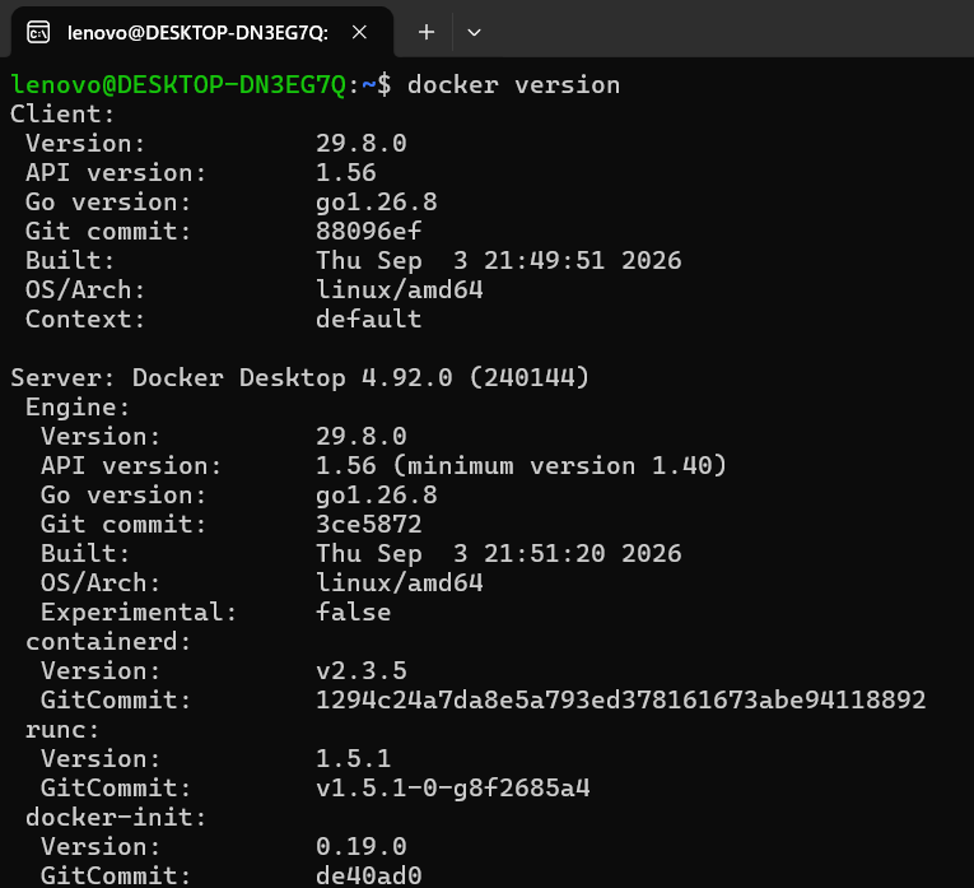
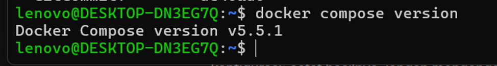
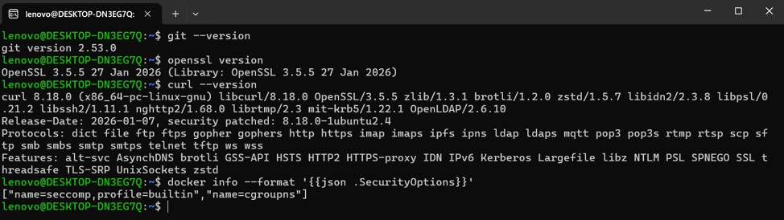
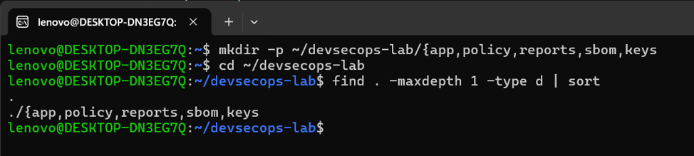
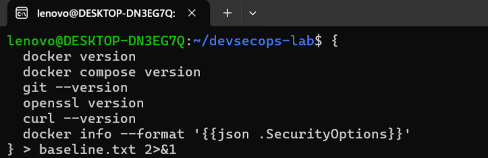
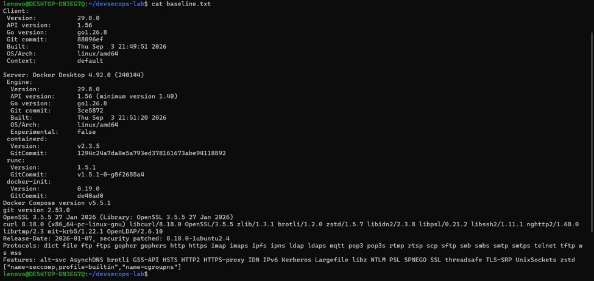

# Praktikum Bab 1 - Baseline Lingkungan DevSecOps

Semua perintah dijalankan di terminal Ubuntu WSL yang terhubung ke Docker Desktop.

## 1. Verifikasi Docker



Jalankan:

```bash
docker version
```

Output menampilkan versi Docker Client dan Server. Ini membuktikan Docker CLI di Ubuntu WSL dapat berkomunikasi dengan Docker Engine milik Docker Desktop.

## 2. Verifikasi Docker Compose



Jalankan:

```bash
docker compose version
```

Output menampilkan versi Docker Compose yang tersedia. Pada praktikum ini, versi yang terlihat adalah `v5.5.1`.

## 3. Periksa alat dan opsi keamanan



Jalankan:

```bash
git --version
openssl version
curl --version
docker info --format '{{json .SecurityOptions}}'
```

Output menunjukkan versi Git, OpenSSL, curl, serta opsi keamanan Docker. Pada gambar, Docker melaporkan `seccomp` dengan profil bawaan dan `cgroups`. Ini membuktikan mekanisme tersebut tersedia, bukan bahwa seluruh container otomatis aman.

## 4. Buat direktori praktikum



Gambar menunjukkan nama folder belum terpisah. Buat folder satu per satu:

```bash
mkdir -p ~/devsecops-lab/app ~/devsecops-lab/policy \
  ~/devsecops-lab/reports ~/devsecops-lab/sbom ~/devsecops-lab/keys
cd ~/devsecops-lab
find . -maxdepth 1 -type d | sort
```

Pastikan hasil menampilkan folder `app`, `policy`, `reports`, `sbom`, dan `keys`.

## 5. Simpan baseline lingkungan



Simpan versi alat dan opsi keamanan ke `baseline.txt`:

```bash
{
  docker version
  docker compose version
  git --version
  openssl version
  curl --version
  docker info --format '{{json .SecurityOptions}}'
} > baseline.txt 2>&1
```

File ini menjadi catatan kondisi alat saat praktikum dilakukan.

## 6. Periksa baseline



Jalankan:

```bash
cat baseline.txt
```

Pastikan versi Docker, Compose, Git, OpenSSL, curl, serta `SecurityOptions` tercatat. Perbarui baseline jika versi alat berubah.

## Hasil

- Docker Client dan Server dapat diakses dari Ubuntu WSL.
- Docker Compose tersedia.
- Versi alat dan opsi keamanan tercatat di `baseline.txt`.
- Direktori praktikum tersedia untuk artefak Bab 1.