# Praktikum Bab 2 - Container dan Docker

Semua perintah dijalankan di terminal Ubuntu WSL yang terhubung ke Docker Desktop.

## 1. Uji instalasi Docker

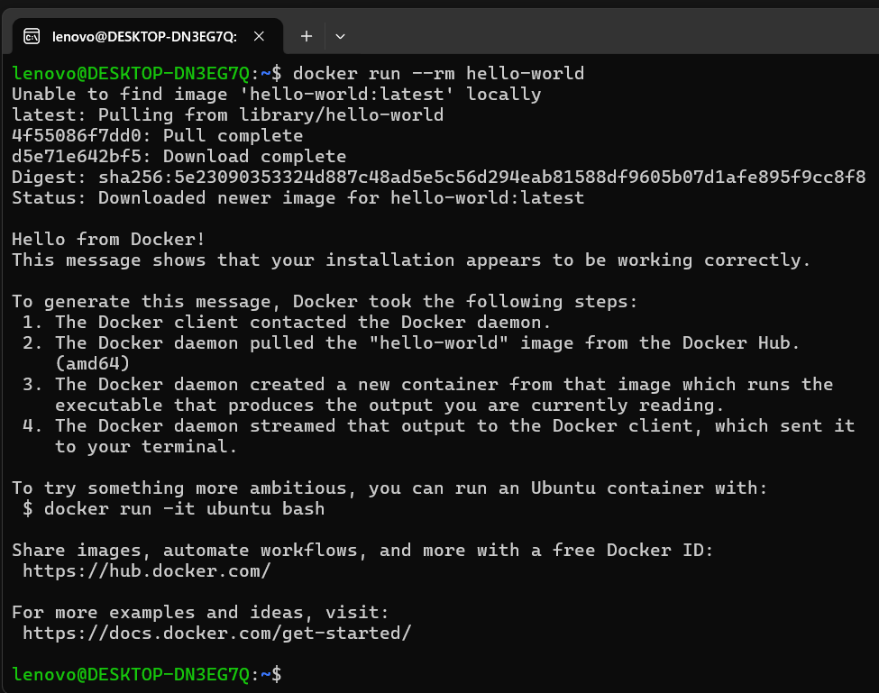

Jalankan:

```bash
docker run --rm hello-world
```

Docker mengunduh image `hello-world`, membuat container sementara, lalu menampilkan pesan sukses. Opsi `--rm` menghapus container setelah proses selesai.

## 2. Periksa daftar container

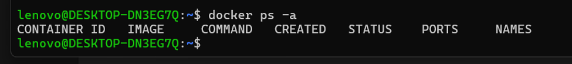

Jalankan:

```bash
docker ps -a
```

Daftar kosong karena container `hello-world` tadi dijalankan dengan `--rm`. Perintah ini menampilkan container yang sedang berjalan maupun yang sudah berhenti.

## 3. Unduh dan jalankan Nginx

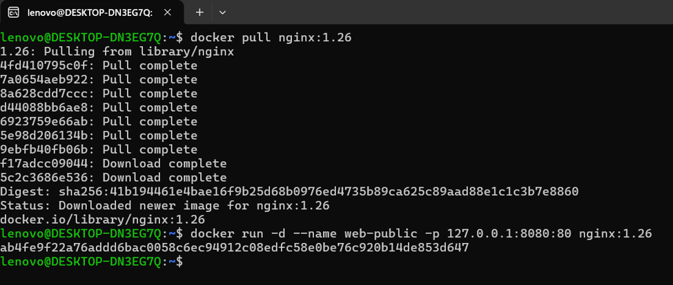

Unduh image dan jalankan container:

```bash
docker pull nginx:1.26
docker run -d --name web-public -p 127.0.0.1:8080:80 nginx:1.26
```

Pemetaan port `127.0.0.1:8080:80` meneruskan port `8080` di komputer ke port `80` di container. Alamat `127.0.0.1` membatasi akses ke komputer lokal.

## 4. Periksa container dan log Nginx

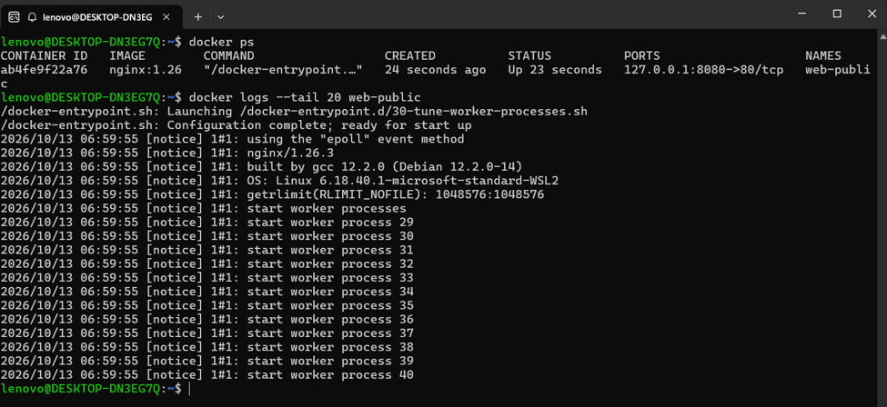

Jalankan:

```bash
docker ps
docker logs --tail 20 web-public
```

Pastikan `web-public` berstatus berjalan dan log menunjukkan Nginx siap menerima koneksi.

## 5. Uji halaman Nginx

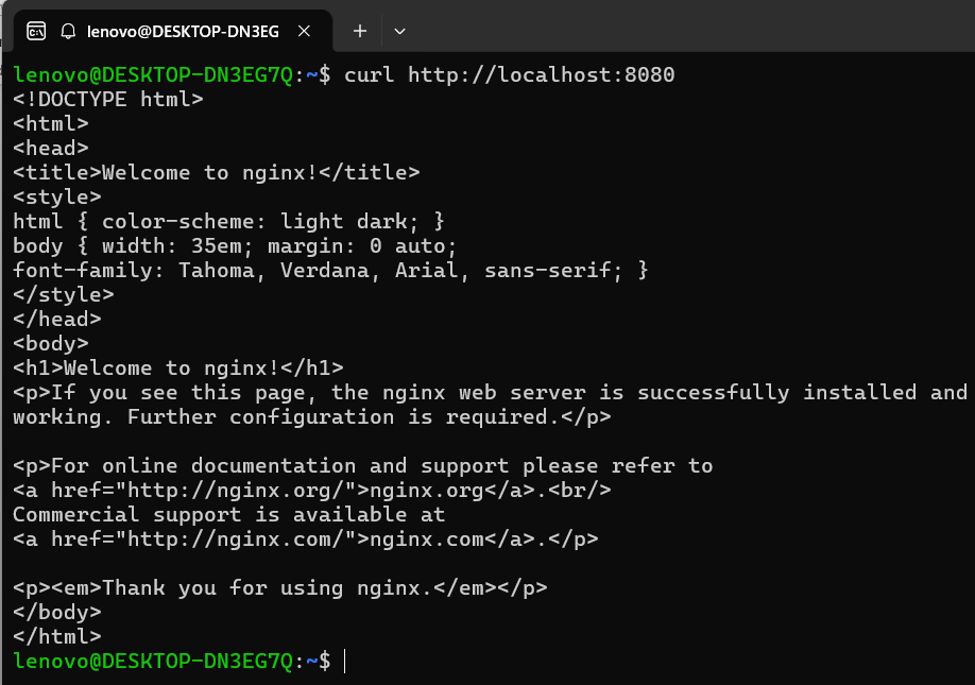

Jalankan:

```bash
curl http://localhost:8080
```

Respons HTML dengan judul `Welcome to nginx!` menandakan port dan web server dapat diakses.

## 6. Jalankan container Ubuntu interaktif

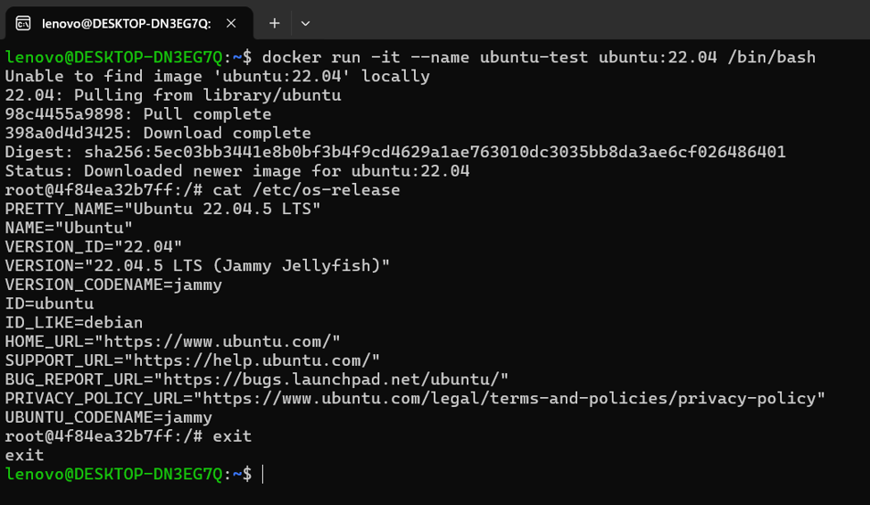

Jalankan:

```bash
docker run -it --name ubuntu-test ubuntu:22.04 /bin/bash
```

Di dalam container, periksa sistem operasi:

```bash
cat /etc/os-release
```

Keluar dari shell container:

```bash
exit
```

Container berhenti setelah keluar, tetapi tetap tersimpan karena perintah `docker run` tidak memakai `--rm`.

## 7. Hapus container percobaan

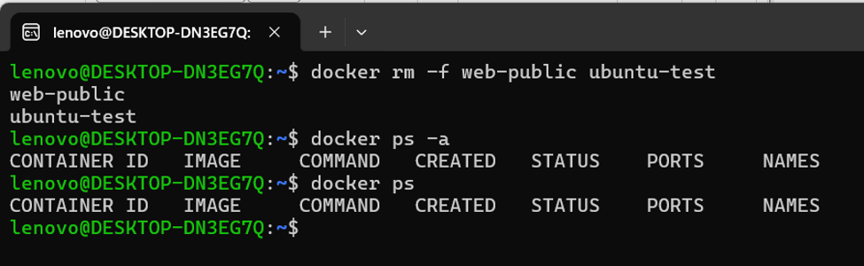

Hapus hanya container praktikum yang dibuat pada langkah sebelumnya:

```bash
docker rm -f web-public ubuntu-test
```

Verifikasi:

```bash
docker ps -a
docker ps
```

Daftar kosong menandakan container percobaan telah dihapus. Perintah ini tidak menghapus image.

## 8. Buat halaman web sederhana

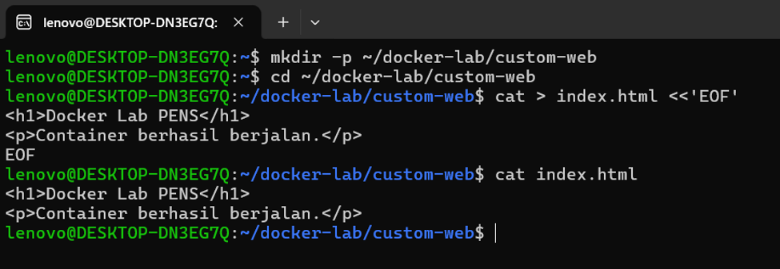

Buat direktori dan file HTML:

```bash
mkdir -p ~/docker-lab/custom-web
cd ~/docker-lab/custom-web

cat > index.html <<'EOF'
<h1>Docker Lab PENS</h1>
<p>Container berhasil berjalan.</p>
EOF
```

Periksa isi file:

```bash
cat index.html
```

## 9. Buat Dockerfile

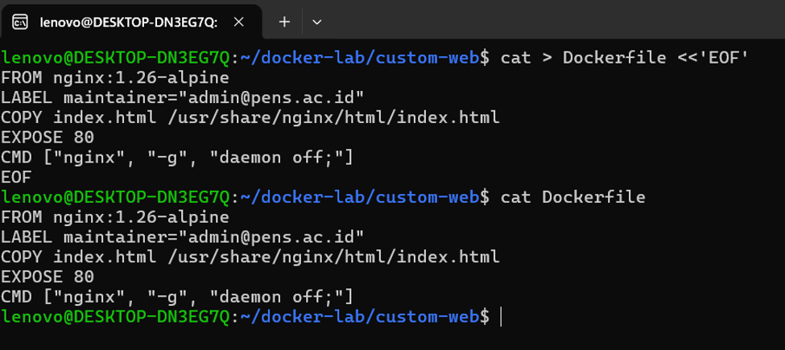

Buat file `Dockerfile`:

```bash
cat > Dockerfile <<'EOF'
FROM nginx:1.26-alpine
LABEL maintainer="admin@pens.ac.id"
COPY index.html /usr/share/nginx/html/index.html
EXPOSE 80
CMD ["nginx", "-g", "daemon off;"]
EOF
```

`FROM` menentukan image dasar. `COPY` memasukkan halaman ke image. `EXPOSE 80` mendokumentasikan port aplikasi, sedangkan `CMD` menjalankan Nginx di foreground.

## 10. Build image aplikasi

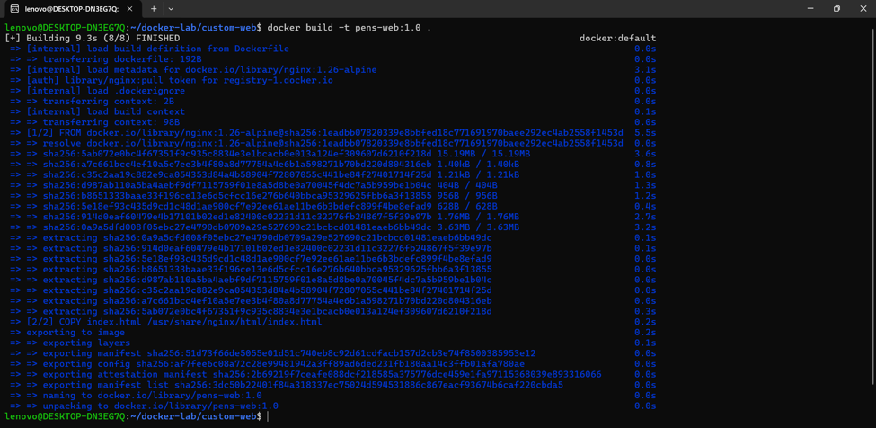

Pastikan berada di direktori `custom-web`, lalu build image:

```bash
cd ~/docker-lab/custom-web
docker build -t pens-web:1.0 .
```

Opsi `-t` memberi nama dan tag pada image. Tanda `.` menentukan direktori build context saat ini.

## 11. Jalankan dan uji aplikasi

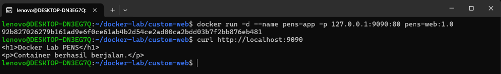

Jalankan container dan uji halaman:

```bash
docker run -d --name pens-app \
  -p 127.0.0.1:9090:80 pens-web:1.0

curl http://localhost:9090
```

Respons diharapkan memuat `Docker Lab PENS` dan `Container berhasil berjalan.` Port host `9090` diteruskan ke port `80` container.

## Hasil

- Image `hello-world` berhasil dijalankan.
- Nginx dapat diakses melalui `http://localhost:8080`.
- Container Ubuntu berjalan secara interaktif.
- Image `pens-web:1.0` berhasil dibangun.
- Halaman custom dapat diakses melalui `http://localhost:9090`.

## Pembersihan opsional

Hapus container dan image praktikum setelah selesai. Perintah ini menghapus objek bernama tersebut:

```bash
docker rm -f pens-app
docker rmi pens-web:1.0 nginx:1.26 ubuntu:22.04 hello-world:latest
```