# Praktikum Bab 3 - Network dan Storage Docker

Semua perintah dijalankan di Ubuntu WSL dari direktori `~/docker-lab/bab-3`.

## 1. Siapkan direktori praktikum

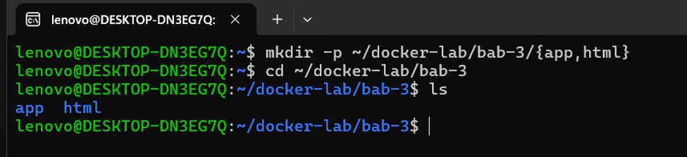

```bash
mkdir -p ~/docker-lab/bab-3/{app,html}
cd ~/docker-lab/bab-3
ls
```

Folder `app` dan `html` disiapkan untuk file aplikasi dan halaman web.

## 2. Buat network dan jalankan container

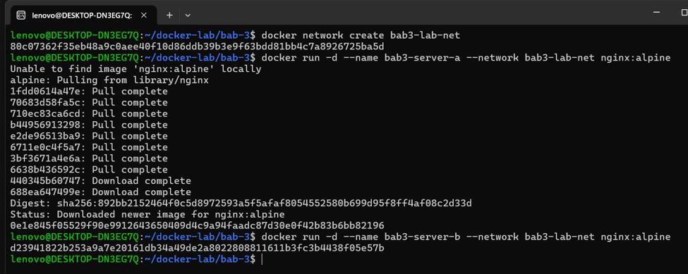

```bash
docker network create bab3-lab-net
docker run -d --name bab3-server-a --network bab3-lab-net nginx:alpine
docker run -d --name bab3-server-b --network bab3-lab-net nginx:alpine
```

Kedua container Nginx bergabung ke user-defined bridge network yang sama.

## 3. Uji komunikasi antarkontainer

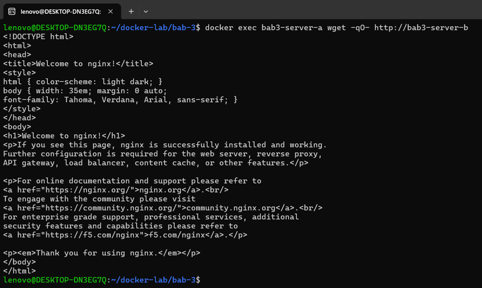

```bash
docker exec bab3-server-a wget -qO- http://bab3-server-b
```

Halaman default Nginx membuktikan container dapat menemukan container lain melalui nama `bab3-server-b`.

## 4. Periksa anggota network

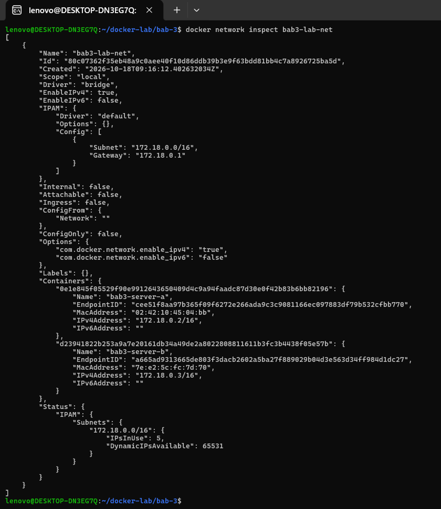

```bash
docker network inspect bab3-lab-net
```

Output menampilkan kedua container sebagai anggota network beserta alamat IP internalnya.

## 5. Hapus container dan network percobaan

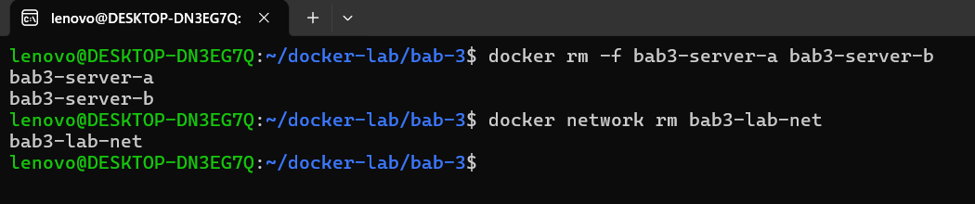

```bash
docker rm -f bab3-server-a bab3-server-b
docker network rm bab3-lab-net
```

Container dan network percobaan dihapus setelah pengujian selesai.

## 6. Buat named volume dan tulis data

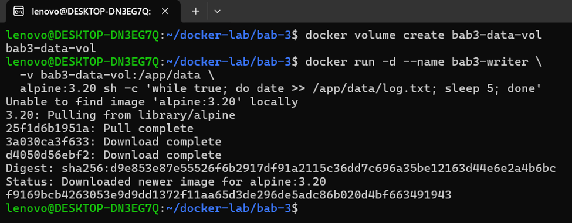

```bash
docker volume create bab3-data-vol

docker run -d --name bab3-writer \
  -v bab3-data-vol:/app/data \
  alpine:3.20 sh -c 'while true; do date >> /app/data/log.txt; sleep 5; done'
```

Container menulis waktu secara berkala ke named volume `bab3-data-vol`.

## 7. Hapus container penulis

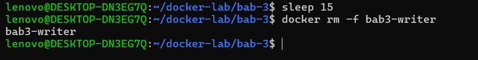

```bash
sleep 15
docker rm -f bab3-writer
```

Container penulis dihapus, tetapi named volume tetap tersedia.

## 8. Verifikasi data tetap tersimpan

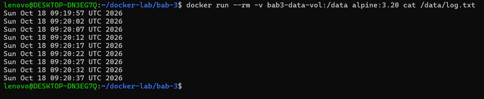

```bash
docker run --rm \
  -v bab3-data-vol:/data \
  alpine:3.20 cat /data/log.txt
```

Isi `log.txt` masih dapat dibaca dari container baru. Data tetap tersimpan di luar lifecycle container penulis.

## 9. Buat backup named volume

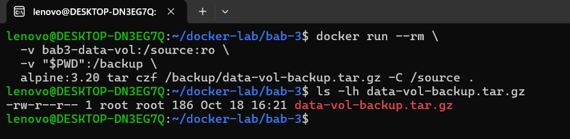

```bash
docker run --rm \
  -v bab3-data-vol:/source:ro \
  -v "$PWD":/backup \
  alpine:3.20 tar czf /backup/data-vol-backup.tar.gz -C /source .

ls -lh data-vol-backup.tar.gz
```

Data volume diarsipkan menjadi `data-vol-backup.tar.gz` pada direktori praktikum.

## 10. Siapkan file untuk bind mount

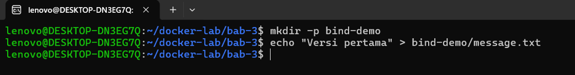

```bash
mkdir -p bind-demo
echo "Versi pertama" > bind-demo/message.txt
```

File dibuat di filesystem Ubuntu WSL agar dapat dibaca container melalui bind mount.

## 11. Baca file dari container

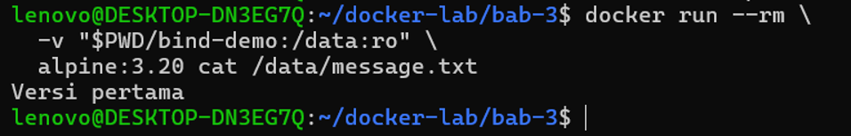

```bash
docker run --rm \
  -v "$PWD/bind-demo:/data:ro" \
  alpine:3.20 cat /data/message.txt
```

Container membaca `Versi pertama` dari file host. Mount menggunakan mode read-only (`:ro`).

## 12. Periksa perubahan file host

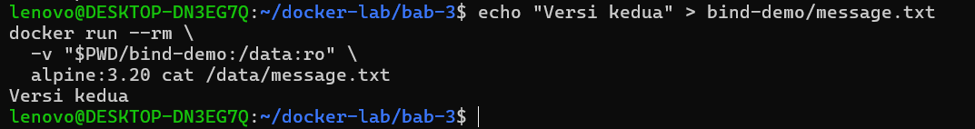

```bash
echo "Versi kedua" > bind-demo/message.txt

docker run --rm \
  -v "$PWD/bind-demo:/data:ro" \
  alpine:3.20 cat /data/message.txt
```

Container membaca `Versi kedua` tanpa perlu rebuild image.

## 13. Buat tmpfs mount

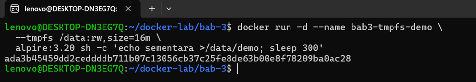

```bash
docker run -d --name bab3-tmpfs-demo \
  --tmpfs /data:rw,size=16m \
  alpine:3.20 sh -c 'echo sementara >/data/demo; sleep 300'
```

Direktori `/data` menggunakan tmpfs dengan batas ukuran 16 MB.

## 14. Baca data lalu hapus container tmpfs

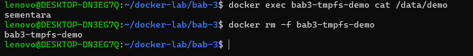

```bash
docker exec bab3-tmpfs-demo cat /data/demo
docker rm -f bab3-tmpfs-demo
```

File sementara terbaca selama container berjalan. Container kemudian dihapus.

## 15. Pastikan data tmpfs tidak bertahan

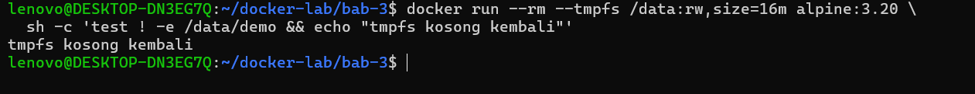

```bash
docker run --rm --tmpfs /data:rw,size=16m alpine:3.20 \
  sh -c 'test ! -e /data/demo && echo "tmpfs kosong kembali"'
```

Container baru tidak menemukan file sebelumnya. Data tmpfs tidak bertahan setelah container dihentikan.

## Hasil

- Container pada network yang sama berkomunikasi menggunakan nama.
- Data named volume tetap tersedia setelah container dihapus dan dapat diarsipkan.
- Bind mount mencerminkan perubahan file host secara langsung.
- Data tmpfs hanya tersedia selama mount dan container terkait berjalan.

## 16. Buat konfigurasi Compose

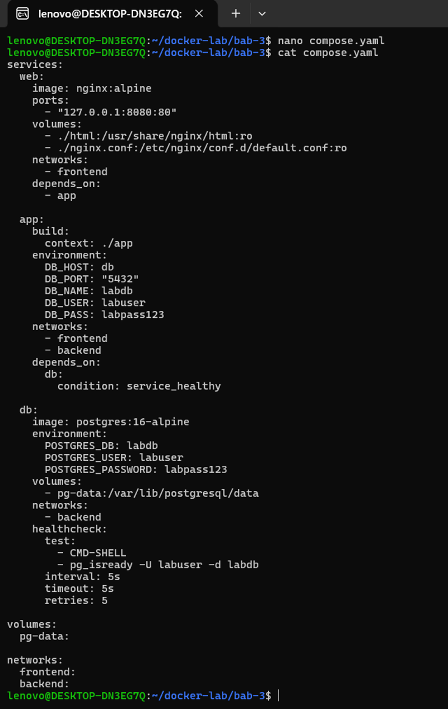

Buat dan periksa file:

```bash
nano compose.yaml
cat compose.yaml
```

Konfigurasi mendefinisikan tiga service: Nginx (`web`), Flask (`app`), dan PostgreSQL (`db`). Nginx terhubung ke network `frontend`; database hanya terhubung ke `backend` dan tidak memublikasikan port ke host. Data PostgreSQL disimpan pada named volume `pg-data`.

## 17. Tambahkan dependensi Flask

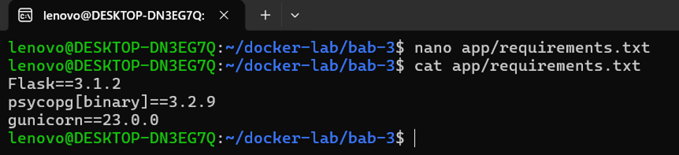

```bash
nano app/requirements.txt
cat app/requirements.txt
```

Dependensi yang digunakan:

```text
Flask==3.1.2
psycopg[binary]==3.2.9
gunicorn==23.0.0
```

## 18. Buat aplikasi Flask

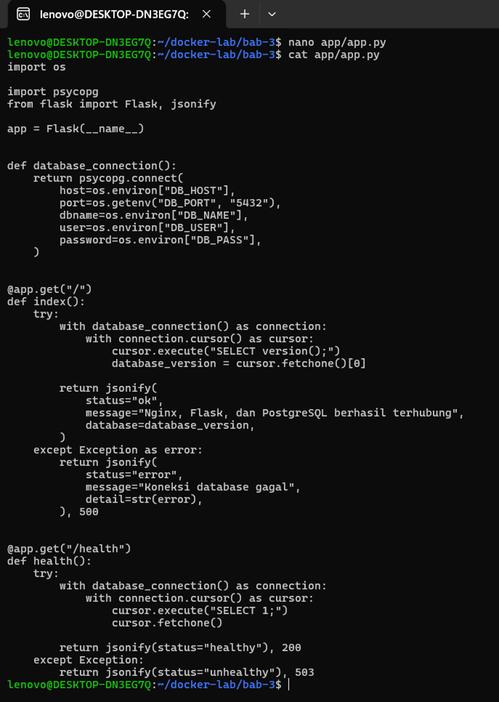

```bash
nano app/app.py
cat app/app.py
```

Aplikasi menyediakan endpoint `/` untuk menguji koneksi PostgreSQL dan `/health` untuk menjalankan pemeriksaan sederhana ke database. Penanganan error rinci pada contoh ini hanya untuk lab; jangan tampilkan detail exception kepada pengguna pada aplikasi produksi.

## 19. Buat Dockerfile aplikasi

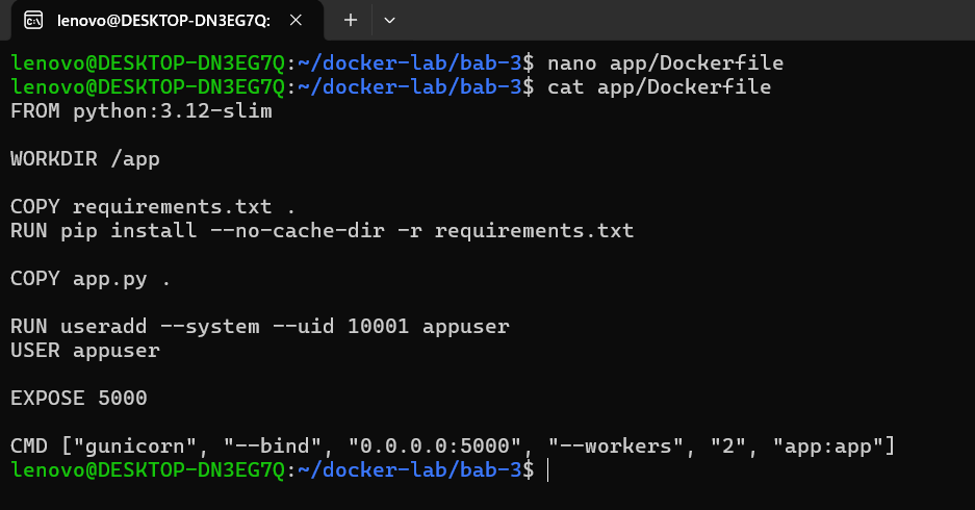

```bash
nano app/Dockerfile
cat app/Dockerfile
```

Dockerfile memasang dependensi, menyalin source, lalu menjalankan Gunicorn sebagai user non-root `appuser`.

## 20. Buat konfigurasi Nginx

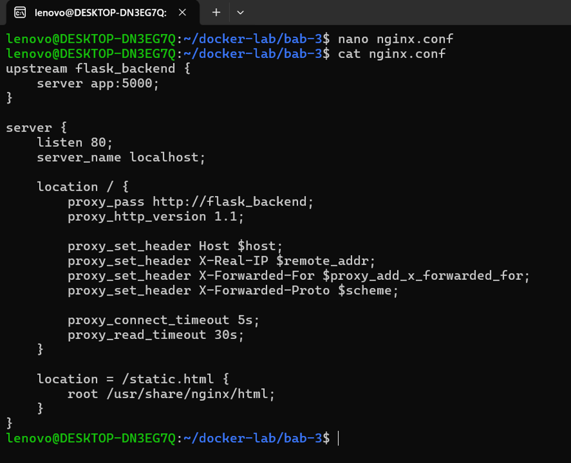

```bash
nano nginx.conf
cat nginx.conf
```

Nginx meneruskan request dinamis ke `app:5000` melalui DNS internal Compose. Route `/static.html` menyajikan file statis dari direktori web.

## 21. Buat halaman statis

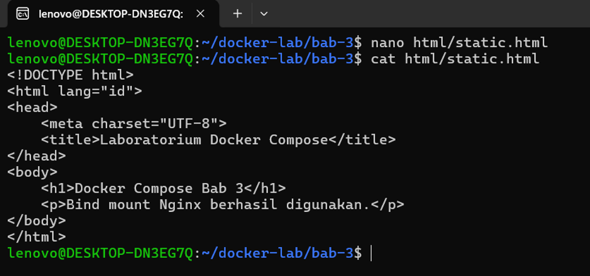

```bash
nano html/static.html
cat html/static.html
```

Halaman ini digunakan untuk menguji bind mount direktori `html` ke container Nginx.

## 22. Validasi konfigurasi Compose

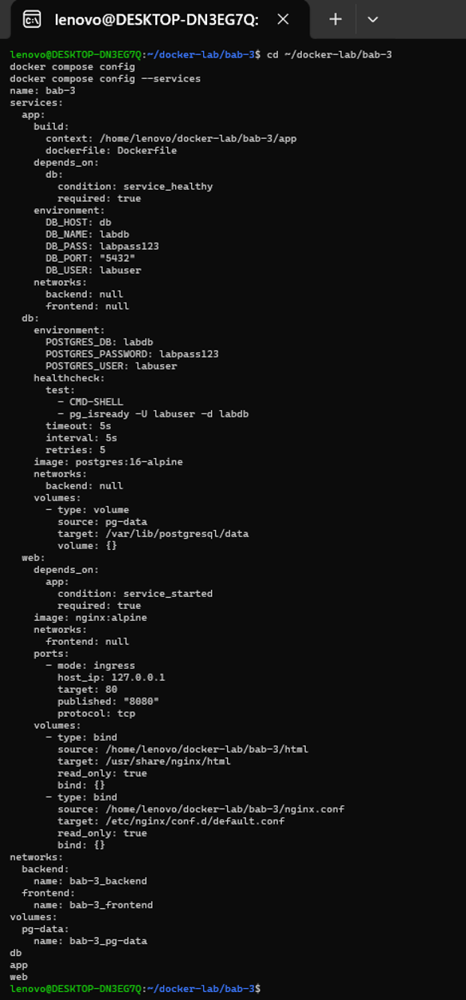

```bash
cd ~/docker-lab/bab-3
docker compose config
docker compose config --services
```

Periksa hasil konfigurasi akhir dan pastikan service `app`, `db`, dan `web` tercantum. Output konfigurasi dapat menampilkan kredensial; jangan unggah screenshot sebelum menyamarkannya.

## 23. Build dan jalankan stack

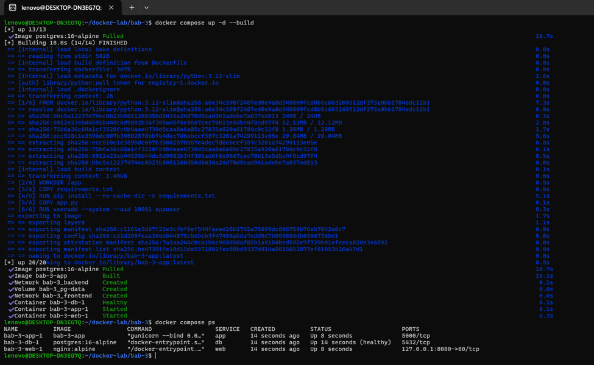

```bash
docker compose up -d --build
docker compose ps
```

Pastikan ketiga service berjalan dan `db` berstatus `healthy`. Pada output, port web tersedia di `127.0.0.1:8080`.

## 24. Periksa log seluruh service

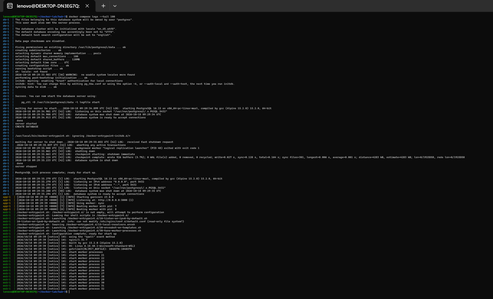

```bash
docker compose logs --tail 100
```

Gunakan log untuk memeriksa proses startup PostgreSQL, Flask, dan Nginx.

## 25. Uji endpoint aplikasi

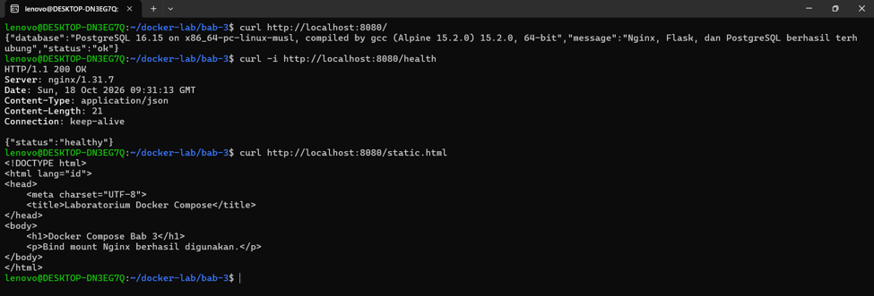

```bash
curl http://localhost:8080/
curl -i http://localhost:8080/health
curl http://localhost:8080/static.html
```

Hasil yang diharapkan:

- `/` mengembalikan status `ok` dan versi PostgreSQL.
- `/health` mengembalikan HTTP `200` dengan status `healthy`.
- `/static.html` menampilkan halaman statis.

## 26. Periksa log tiap service

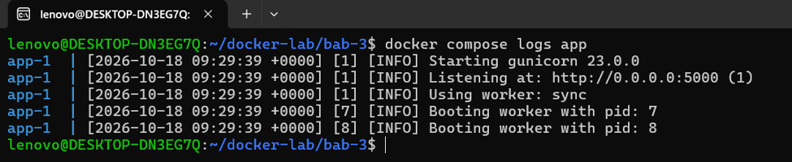

```bash
docker compose logs app
```

Log menunjukkan Gunicorn berjalan dan mendengarkan pada port `5000`.

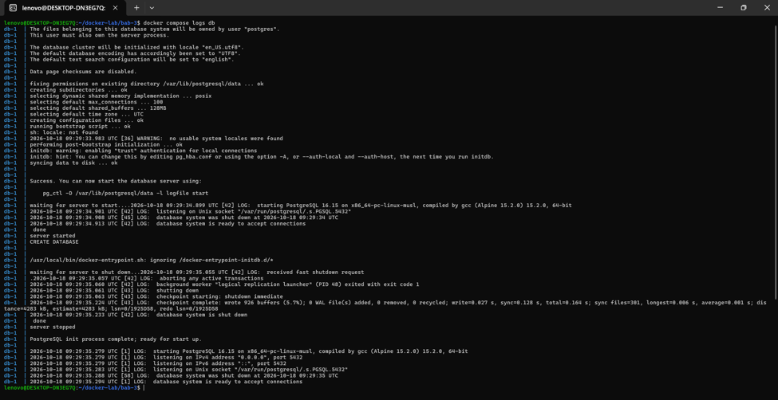

```bash
docker compose logs db
```

Log PostgreSQL digunakan untuk memeriksa inisialisasi database dan kesiapan menerima koneksi.

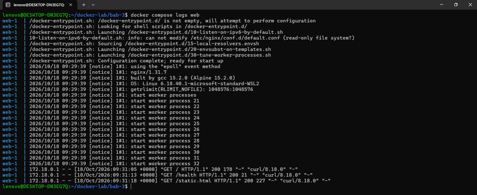

```bash
docker compose logs web
```

Log Nginx menunjukkan startup web server dan request yang diterima.

## 27. Periksa network dan volume

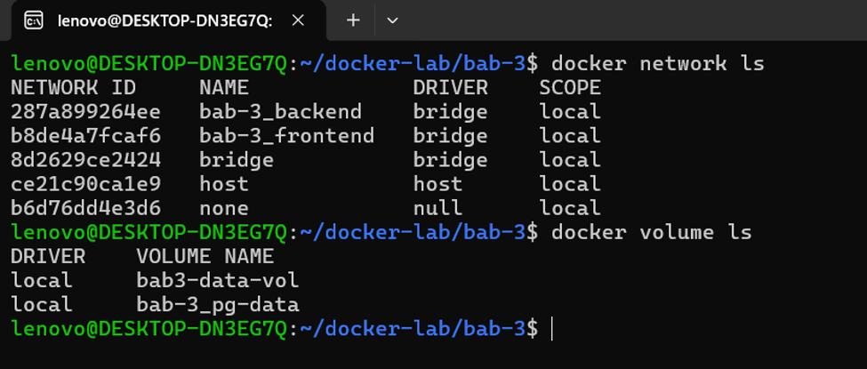

```bash
docker network ls
docker volume ls
```

Compose membuat network terpisah untuk `frontend` dan `backend`, serta named volume PostgreSQL. Volume `bab3-data-vol` berasal dari latihan named volume sebelumnya.

## 28. Hentikan stack dan hapus volume database

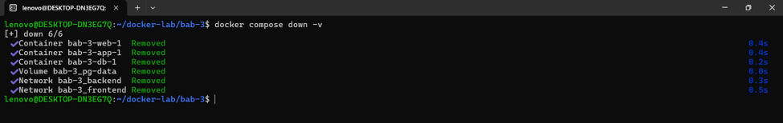

```bash
docker compose down -v
```

Perintah ini menghapus container, network Compose, dan named volume `pg-data`. **Seluruh data PostgreSQL pada volume tersebut terhapus.** Jangan gunakan opsi `-v` jika ingin mempertahankan data database.

## Hasil

- Compose menjalankan Nginx, Flask, dan PostgreSQL.
- Nginx meneruskan request ke Flask; Flask berhasil berkomunikasi dengan PostgreSQL.
- Health endpoint dan halaman statis berhasil diuji.
- Network memisahkan jalur frontend dan backend.
- `docker compose down -v` menghapus volume database proyek.