# Praktikum Bab 4 - Reverse Proxy dan TLS

Praktikum menggunakan Nginx sebagai reverse proxy untuk Apache dan Flask. Perintah dijalankan di Ubuntu WSL.

## 1. Siapkan direktori kerja

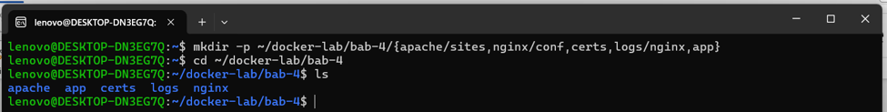

```bash
mkdir -p ~/docker-lab/bab-4/{apache/sites,nginx/conf,certs,logs/nginx,app}
cd ~/docker-lab/bab-4
ls
```

Direktori disiapkan untuk konfigurasi Nginx, halaman Apache, aplikasi Flask, sertifikat, dan log.

## 2. Buat sertifikat TLS self-signed

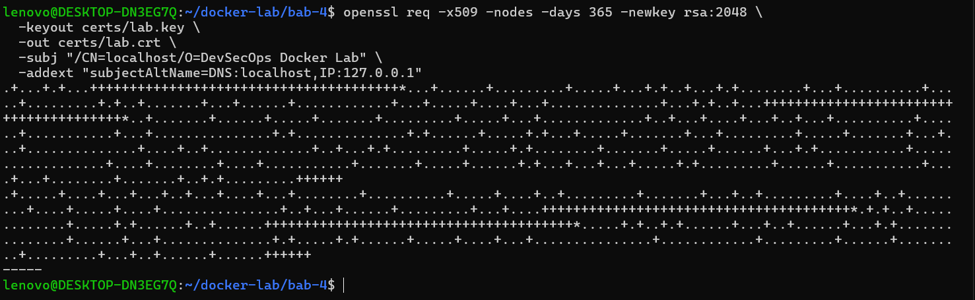

```bash
openssl req -x509 -nodes -days 365 -newkey rsa:2048 \
  -keyout certs/lab.key \
  -out certs/lab.crt \
  -subj "/CN=localhost/O=DevSecOps Docker Lab" \
  -addext "subjectAltName=DNS:localhost,IP:127.0.0.1"
```

Sertifikat berlaku 365 hari, menggunakan RSA 2048-bit, dan mencantumkan `localhost` serta `127.0.0.1`.

## 3. Batasi akses private key

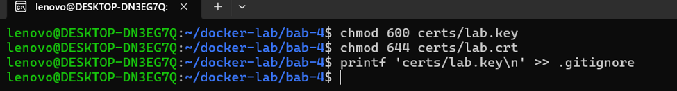

```bash
chmod 600 certs/lab.key
chmod 644 certs/lab.crt
printf 'certs/lab.key\n' >> .gitignore
```

Private key dibatasi agar hanya pemilik file yang dapat membacanya, dan dikecualikan dari Git. Jangan unggah `certs/lab.key` ke repository.

## 4. Buat konfigurasi Compose

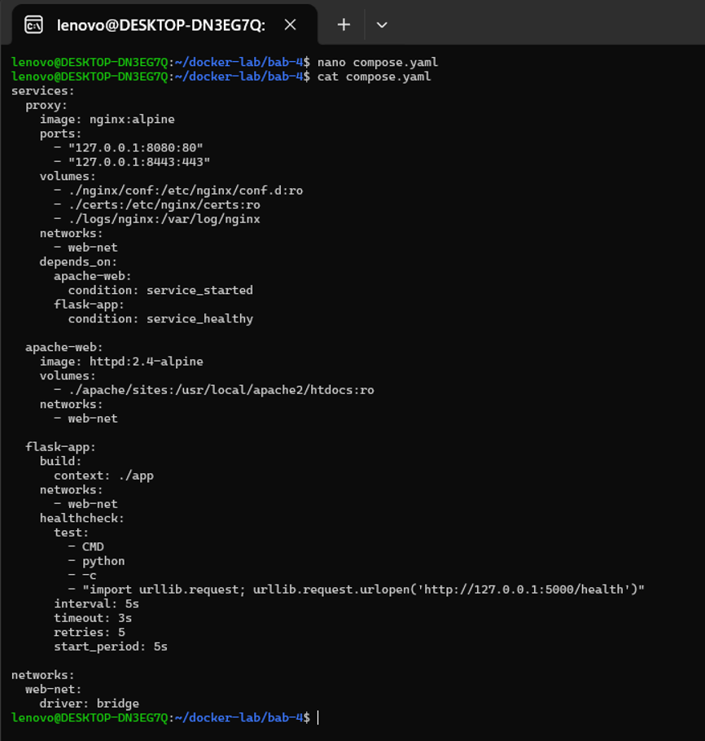

```bash
nano compose.yaml
```

Isi file mengatur tiga service: `proxy`, `apache-web`, dan `flask-app`. Hanya Nginx yang memiliki port host, yaitu `8080` untuk HTTP dan `8443` untuk HTTPS. Ketiganya terhubung melalui network `web-net`.

## 5. Konfigurasikan Nginx

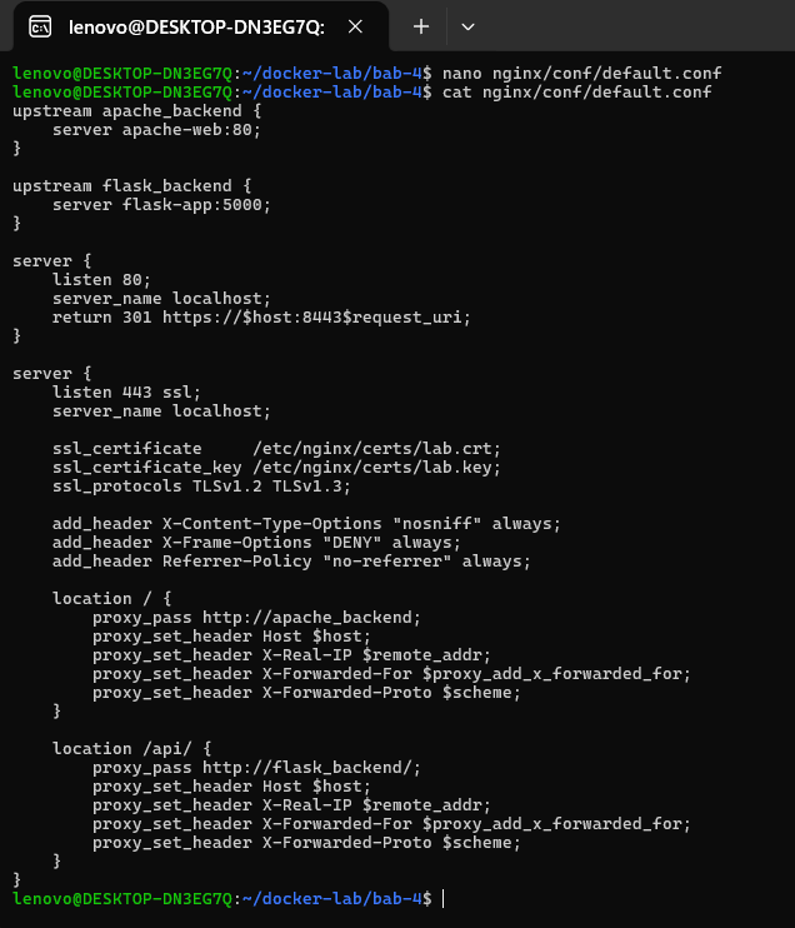

Buat `nginx/conf/default.conf`. Konfigurasi mengalihkan HTTP ke HTTPS, meneruskan halaman utama ke Apache, dan meneruskan `/api/` ke Flask.

```nginx
upstream apache_backend {
    server apache-web:80;
}

upstream flask_backend {
    server flask-app:5000;
}

server {
    listen 80;
    server_name localhost;
    return 301 https://$host:8443$request_uri;
}

server {
    listen 443 ssl;
    server_name localhost;

    ssl_certificate     /etc/nginx/certs/lab.crt;
    ssl_certificate_key /etc/nginx/certs/lab.key;
    ssl_protocols TLSv1.2 TLSv1.3;

    add_header X-Content-Type-Options "nosniff" always;
    add_header X-Frame-Options "DENY" always;
    add_header Referrer-Policy "no-referrer" always;

    location / {
        proxy_pass http://apache_backend;
        proxy_set_header Host $host;
        proxy_set_header X-Real-IP $remote_addr;
        proxy_set_header X-Forwarded-For $proxy_add_x_forwarded_for;
        proxy_set_header X-Forwarded-Proto $scheme;
    }

    location /api/ {
        proxy_pass http://flask_backend/;
        proxy_set_header Host $host;
        proxy_set_header X-Real-IP $remote_addr;
        proxy_set_header X-Forwarded-For $proxy_add_x_forwarded_for;
        proxy_set_header X-Forwarded-Proto $scheme;
    }
}
```

## 6. Buat halaman Apache

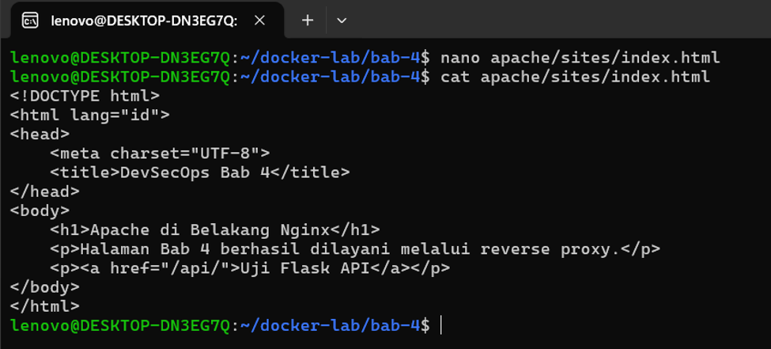

Buat `apache/sites/index.html` sebagai halaman uji. Tautan `/api/` digunakan untuk mengakses backend Flask melalui reverse proxy.

## 7. Tentukan dependensi Flask

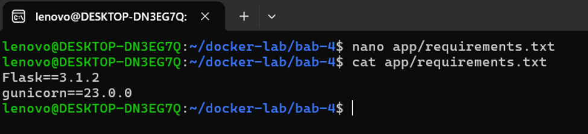

Buat `app/requirements.txt`:

```text
Flask==3.1.2
gunicorn==23.0.0
```

## 8. Buat aplikasi Flask

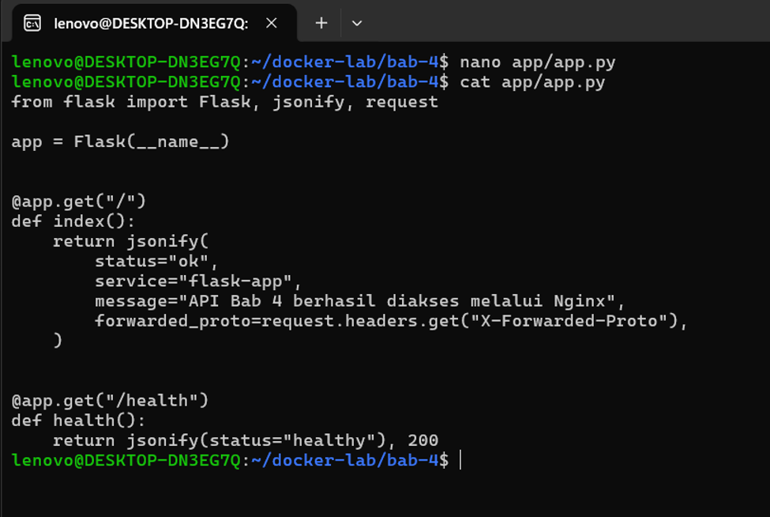

Buat `app/app.py`. Aplikasi menyediakan endpoint `/` untuk mengembalikan informasi API dan `/health` untuk healthcheck.

## 9. Buat Dockerfile Flask

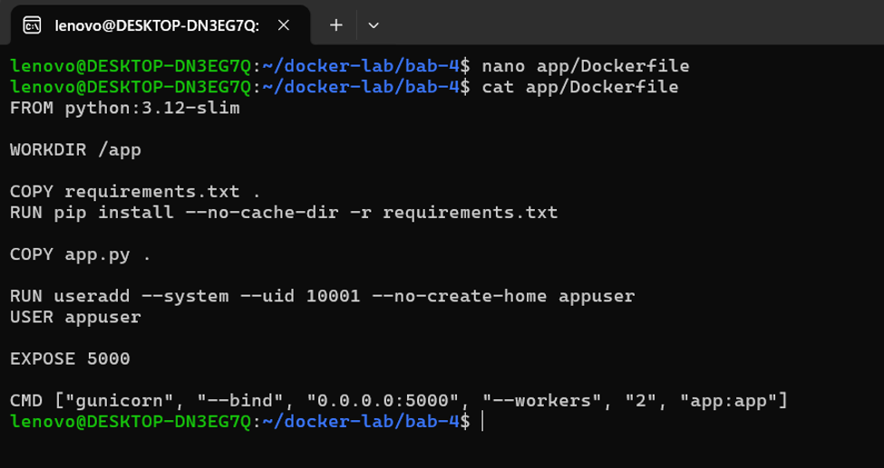

Buat `app/Dockerfile`. Image memasang dependensi lalu menjalankan Gunicorn sebagai user non-root `appuser`.

## 10. Validasi konfigurasi Compose

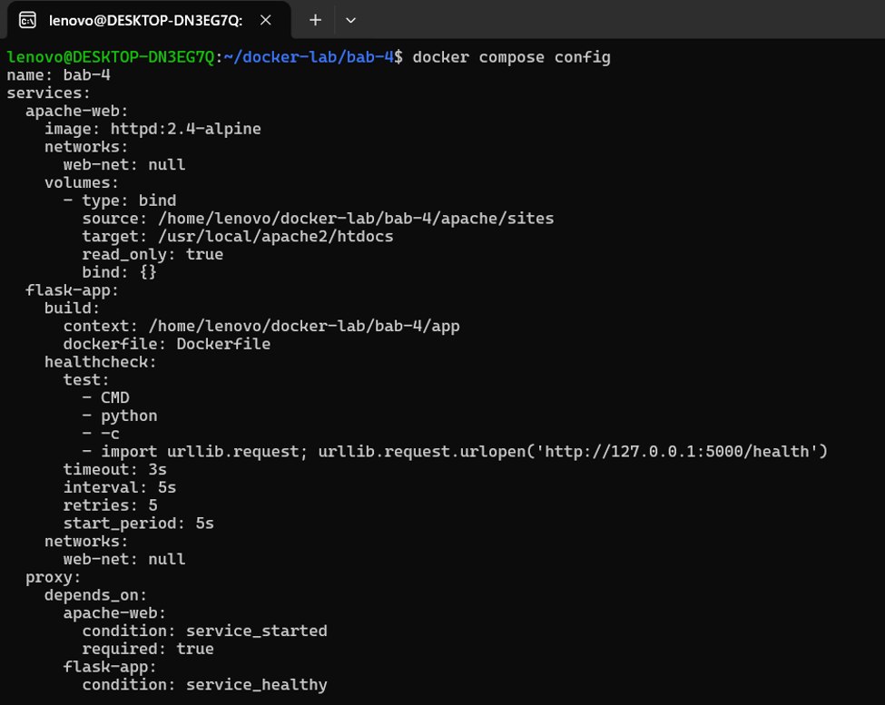

```bash
docker compose config
```

Periksa hasil gabungan konfigurasi Compose. Pastikan port, volume, healthcheck, dan network sudah sesuai.

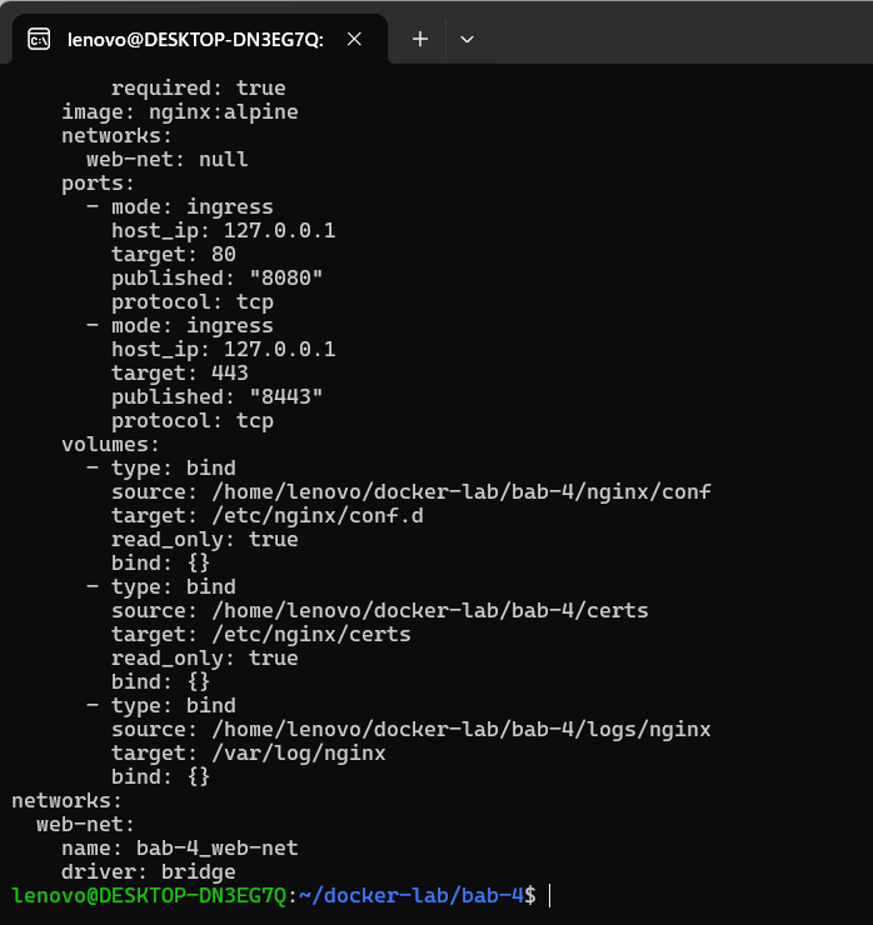

Output menunjukkan port Nginx terikat pada `127.0.0.1`; konfigurasi dan sertifikat dipasang read-only.

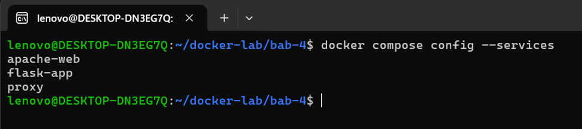

```bash
docker compose config --services
```

Pastikan service berikut tampil:

```text
apache-web
flask-app
proxy
```

## 11. Build dan jalankan stack

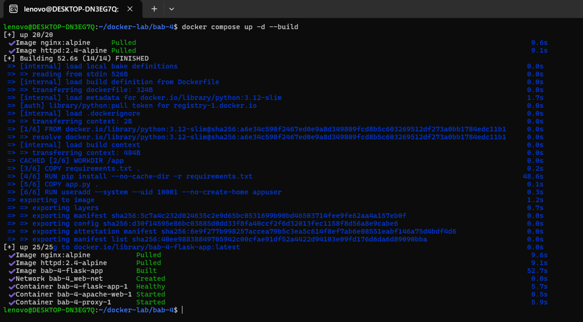

```bash
docker compose up -d --build
```

Compose membangun image Flask, mengunduh image Nginx dan Apache, lalu membuat network dan container.

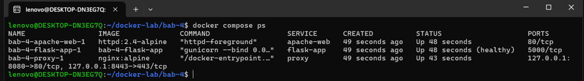

```bash
docker compose ps
```

Pastikan semua service berjalan dan `flask-app` berstatus `healthy`. Published port hanya terlihat pada service `proxy`.

## 12. Uji HTTP redirect

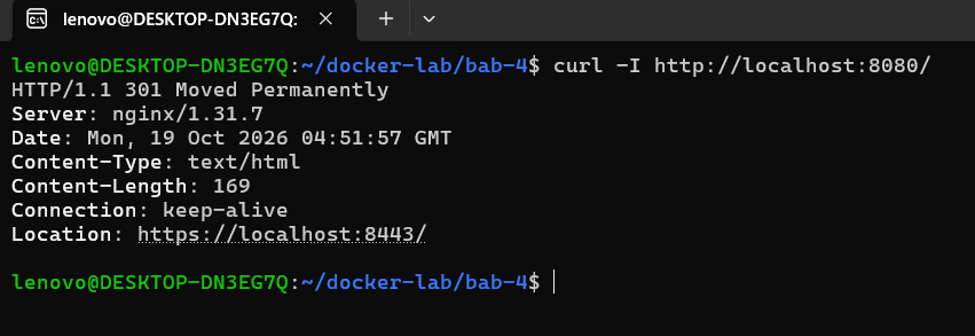

```bash
curl -I http://localhost:8080/
```

Respons `301 Moved Permanently` dan header `Location` menunjukkan HTTP diarahkan ke HTTPS pada port `8443`.

## 13. Uji halaman Apache melalui HTTPS

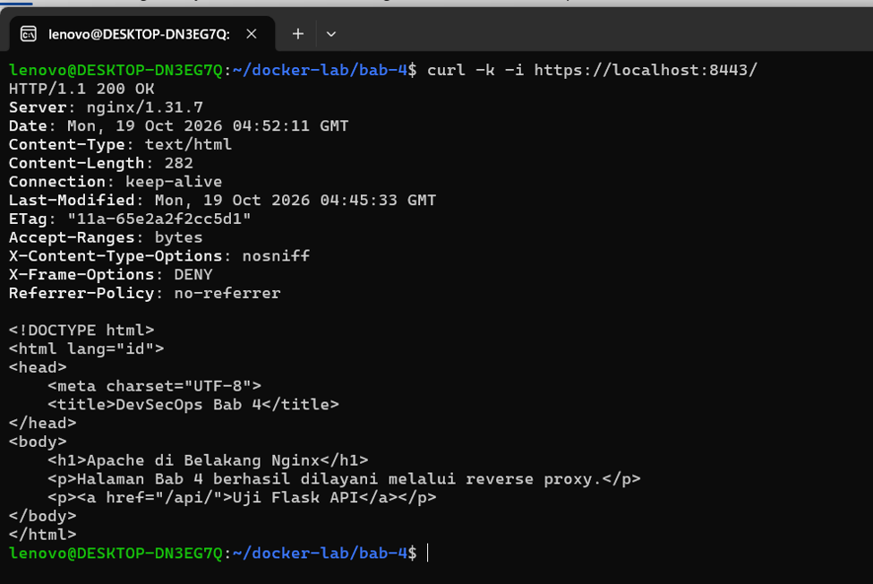

```bash
curl -k -i https://localhost:8443/
```

Respons `200 OK` dan halaman HTML membuktikan Nginx menerima HTTPS lalu meneruskan request ke Apache. Opsi `-k` hanya digunakan karena sertifikat lab bersifat self-signed.

## 14. Uji Flask API dan health endpoint

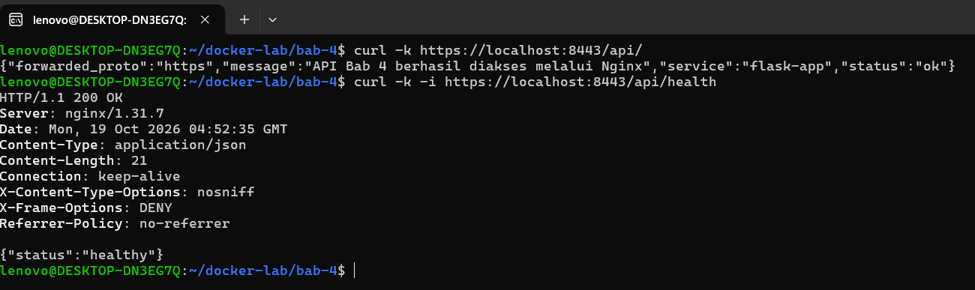

```bash
curl -k https://localhost:8443/api/
curl -k -i https://localhost:8443/api/health
```

API mengembalikan JSON dengan status `ok`; health endpoint mengembalikan HTTP `200` dan status `healthy`. Nilai `forwarded_proto` menunjukkan request diteruskan melalui HTTPS.

## 15. Periksa koneksi TLS

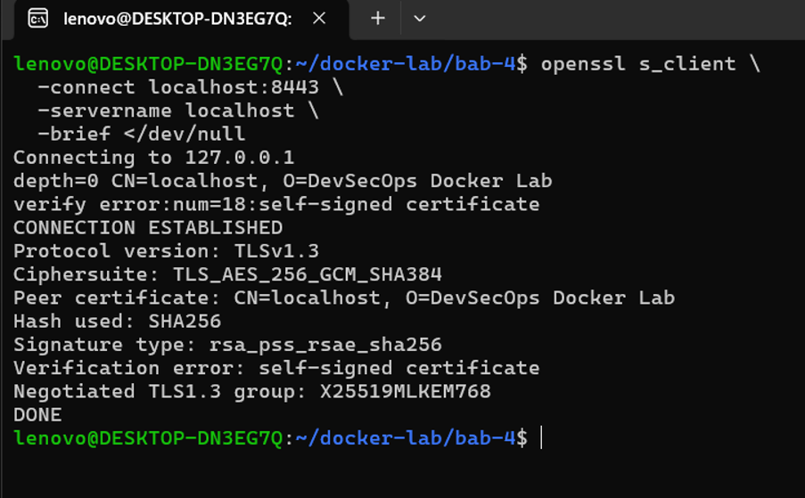

```bash
openssl s_client \
  -connect localhost:8443 \
  -servername localhost \
  -brief </dev/null
```

Handshake berhasil menggunakan TLS 1.3. Pesan `self-signed certificate` wajar untuk sertifikat lab dan berarti sertifikat belum dipercaya oleh CA sistem.

## 16. Uji akses internal dari proxy

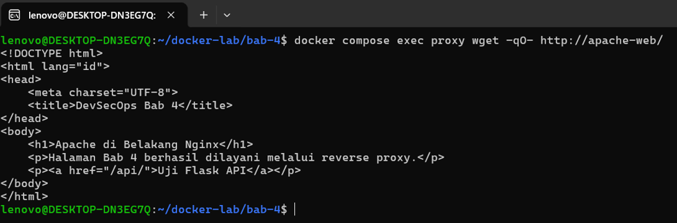

```bash
docker compose exec proxy wget -qO- http://apache-web/
```

Proxy dapat menjangkau Apache menggunakan nama service Compose `apache-web`.

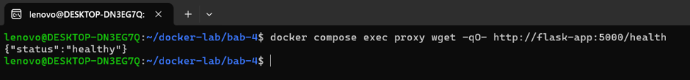

```bash
docker compose exec proxy wget -qO- http://flask-app:5000/health
```

Proxy dapat menjangkau Flask melalui network internal. Apache dan Flask tidak memublikasikan port ke host.

## 17. Periksa log service

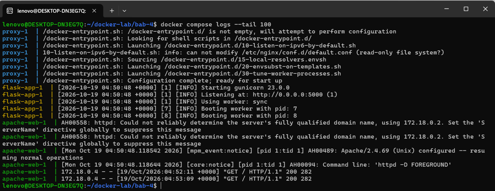

```bash
docker compose logs --tail 100
```

Log menunjukkan startup Nginx, Apache, dan Gunicorn. Apache juga mencatat peringatan bahwa `ServerName` belum ditetapkan; pada praktikum ini halaman tetap berhasil dilayani.

## 18. Periksa access log Nginx

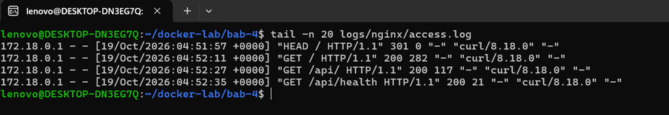

```bash
tail -n 20 logs/nginx/access.log
```

Access log mencatat request yang diuji, termasuk redirect HTTP, halaman Apache, dan endpoint Flask.

## 19. Hentikan stack

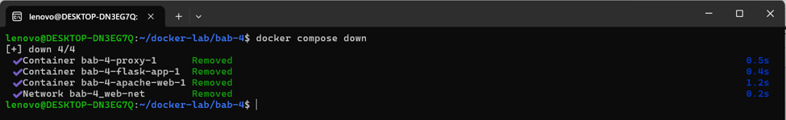

```bash
docker compose down
```

Container dan network Compose dihapus. File konfigurasi, sertifikat, dan log lokal tetap berada di direktori praktikum.

## Hasil

- HTTP pada port `8080` mengalihkan request ke HTTPS.
- Nginx meneruskan halaman web ke Apache dan `/api/` ke Flask.
- Flask berstatus `healthy`; endpoint API merespons dengan sukses.
- TLS 1.3 berhasil digunakan dengan sertifikat self-signed.
- Hanya Nginx yang memiliki published port.
- Access log Nginx mencatat request praktikum.