# Praktikum Bab 5 - PostgreSQL, pgAdmin, Backup, dan Restore

Praktikum dijalankan di Ubuntu WSL dari `~/docker-lab/bab-5`.

## 1. Siapkan direktori

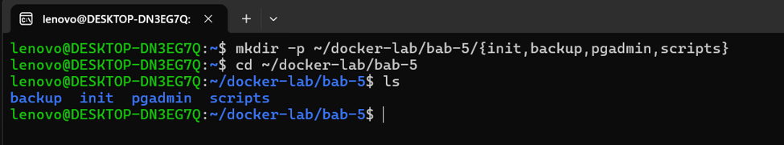

```bash
mkdir -p ~/docker-lab/bab-5/{init,backup,pgadmin,scripts}
cd ~/docker-lab/bab-5
ls
```

Folder `init`, `backup`, `pgadmin`, dan `scripts` disiapkan untuk file praktikum.

## 2. Buat template konfigurasi

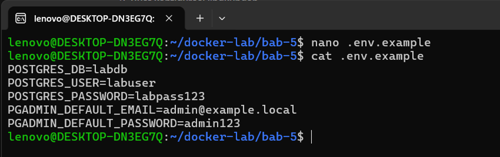

Buat `.env.example` berisi konfigurasi PostgreSQL dan pgAdmin. Gunakan alamat email yang valid, misalnya `admin@example.com`; domain `.local` dapat ditolak pgAdmin.

```dotenv
POSTGRES_DB=labdb
POSTGRES_USER=labuser
POSTGRES_PASSWORD=ganti-dengan-password-lab
PGADMIN_DEFAULT_EMAIL=admin@example.com
PGADMIN_DEFAULT_PASSWORD=ganti-dengan-password-lab
```

## 3. Buat konfigurasi lokal

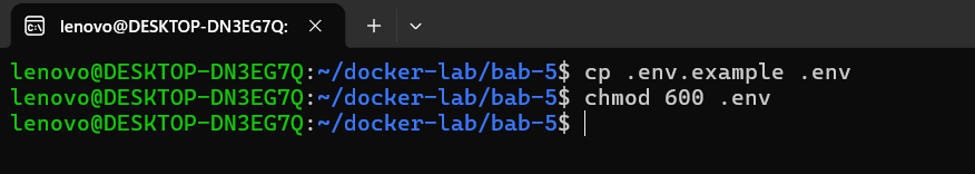

```bash
cp .env.example .env
chmod 600 .env
```

`chmod 600` membatasi akses file `.env` ke pemiliknya. Sesuaikan password lokal sebelum menjalankan stack.

## 4. Abaikan file rahasia dan backup

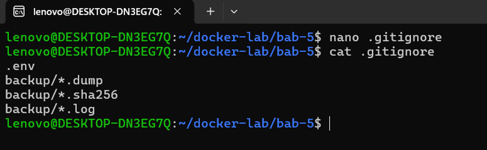

Buat `.gitignore`:

```gitignore
.env
backup/*.dump
backup/*.sha256
backup/*.log
```

Aturan ini mencegah file konfigurasi rahasia dan backup ikut di-commit.

## 5. Buat schema dan data awal

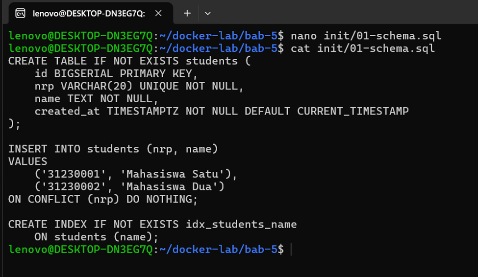

Simpan SQL pada `init/01-schema.sql`. Script membuat tabel `students`, constraint unik pada `nrp`, indeks nama, serta dua data awal. Init script hanya dijalankan saat volume PostgreSQL masih kosong.

## 6. Konfigurasikan server pgAdmin

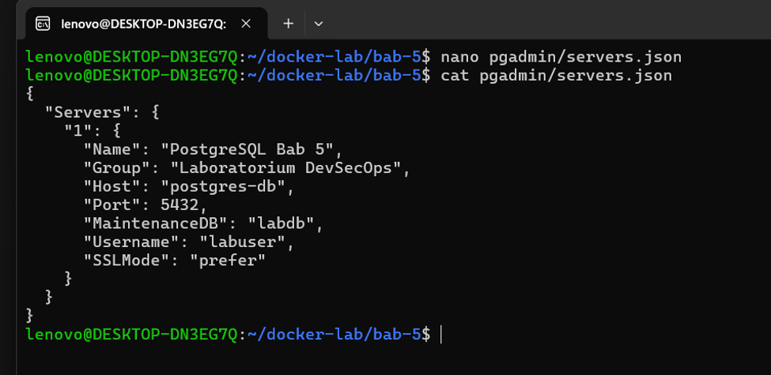

Simpan konfigurasi pada `pgadmin/servers.json`. Host database menggunakan `postgres-db`, nama service Compose, bukan `localhost`.

```json
{
  "Servers": {
    "1": {
      "Name": "PostgreSQL Bab 5",
      "Group": "Laboratorium DevSecOps",
      "Host": "postgres-db",
      "Port": 5432,
      "MaintenanceDB": "labdb",
      "Username": "labuser",
      "SSLMode": "prefer"
    }
  }
}
```

## 7. Konfigurasikan PostgreSQL dan pgAdmin

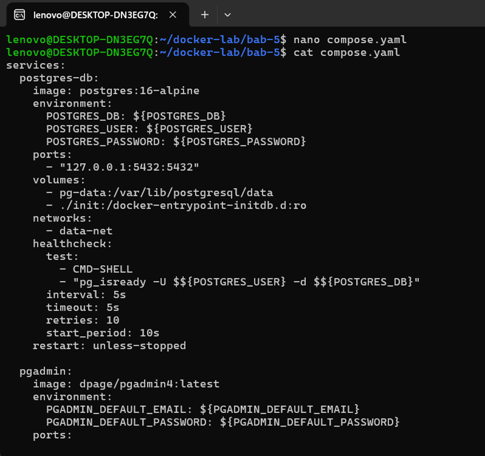

File `compose.yaml` mendefinisikan PostgreSQL dengan volume data, init script, healthcheck, dan port lokal `127.0.0.1:5432:5432`. pgAdmin memakai port lokal `127.0.0.1:5050:80`.

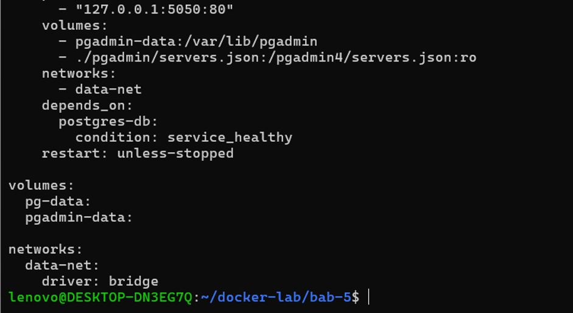

Named volume `pg-data` menyimpan data PostgreSQL; `pgadmin-data` menyimpan konfigurasi pgAdmin. Kedua service berbagi network internal `data-net`.

## 8. Validasi konfigurasi Compose

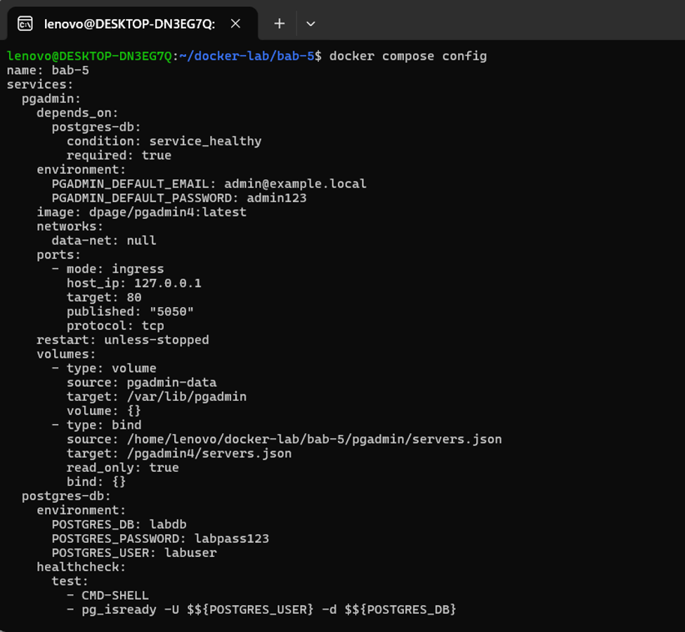

```bash
docker compose config
```

Periksa hasil konfigurasi akhir. Output dapat menampilkan password; samarkan sebelum mengambil atau membagikan screenshot.

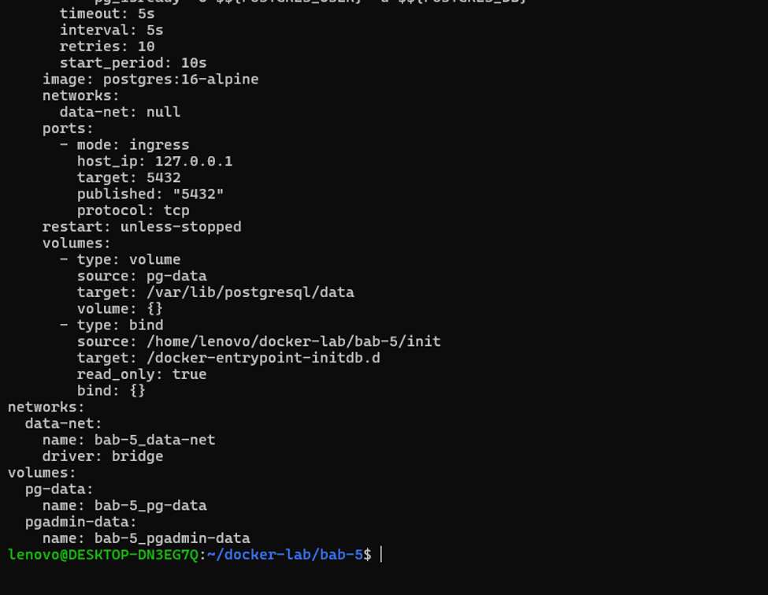

Pastikan port terikat ke `127.0.0.1`, volume terpasang pada lokasi yang tepat, dan service memakai network yang sama.

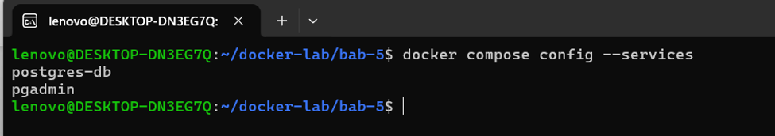

```bash
docker compose config --services
```

Service yang diharapkan: `postgres-db` dan `pgadmin`.

## 9. Jalankan stack dan periksa status

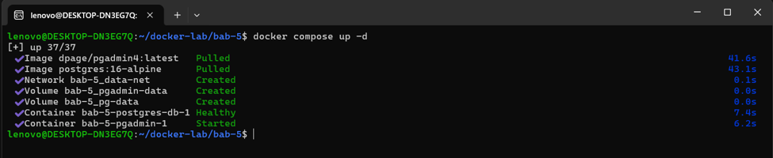

```bash
docker compose up -d
```

Compose membuat network dan volume, lalu menjalankan kedua container.

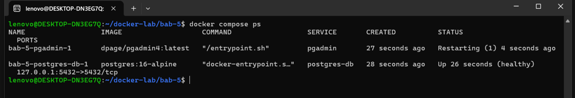

Pada percobaan awal, PostgreSQL sudah `healthy`, tetapi pgAdmin terus restart. Status sehat PostgreSQL tidak berarti pgAdmin sudah berjalan.

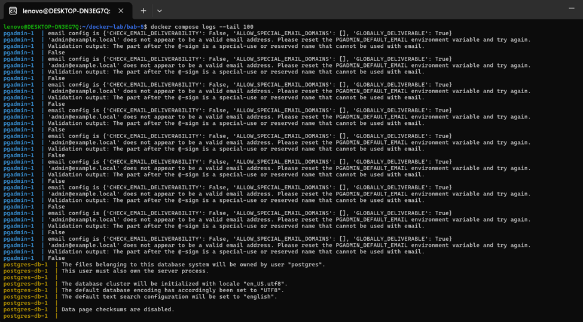

Log menunjukkan alamat email `.local` ditolak. Ganti `PGADMIN_DEFAULT_EMAIL` pada `.env` ke alamat valid, misalnya `admin@example.com`, lalu buat ulang pgAdmin:

```bash
docker compose up -d --force-recreate pgadmin
```

## 10. Periksa PostgreSQL

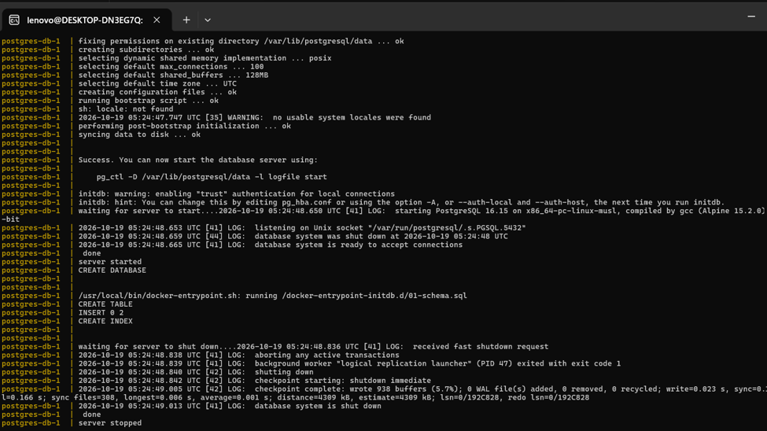

```bash
docker compose logs --tail 100 postgres-db
```

Log menunjukkan PostgreSQL membuat database dan menjalankan `init/01-schema.sql`.

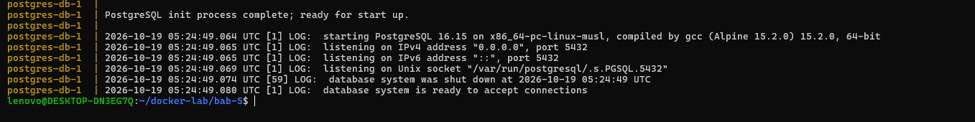

Periksa kembali log sampai PostgreSQL siap menerima koneksi dan status service menjadi `healthy`.

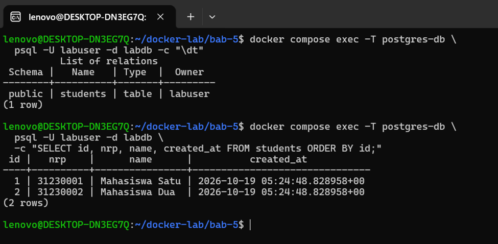

```bash
docker compose exec -T postgres-db \
  psql -U labuser -d labdb -c "\dt"

docker compose exec -T postgres-db \
  psql -U labuser -d labdb \
  -c "SELECT id, nrp, name, created_at FROM students ORDER BY id;"
```

Tabel `students` dan dua baris data awal berhasil dibuat.

## 11. Masuk dan hubungkan pgAdmin

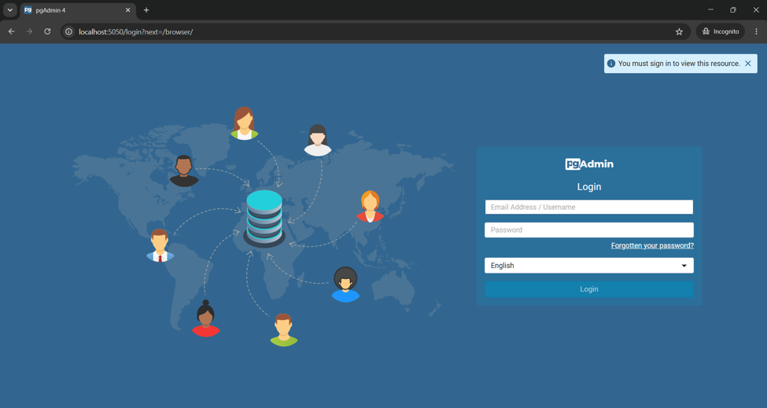

Buka `http://localhost:5050`. Login menggunakan email dan password pgAdmin dari `.env`.

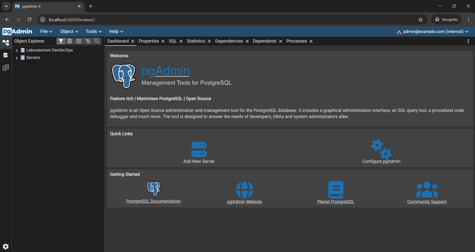

Server PostgreSQL tersedia pada daftar server pgAdmin.

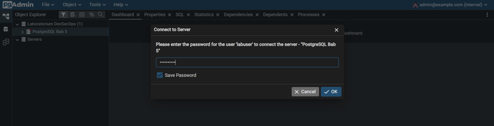

Saat diminta, masukkan password PostgreSQL untuk user `labuser`. Opsi **Save Password** menyimpan password pada profil pgAdmin lokal.

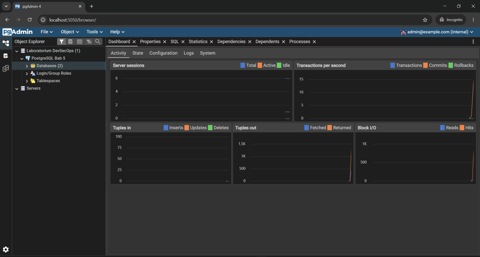

Dashboard server tampil setelah koneksi berhasil. Ini membuktikan pgAdmin dapat mengakses PostgreSQL melalui network Compose.

## 12. Tambahkan data untuk uji persistensi

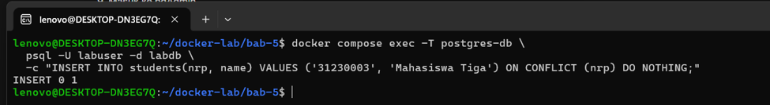

```bash
docker compose exec -T postgres-db \
  psql -U labuser -d labdb \
  -c "INSERT INTO students(nrp, name) VALUES ('31230003', 'Mahasiswa Tiga') ON CONFLICT (nrp) DO NOTHING;"
```

Record baru ditambahkan untuk menguji apakah data bertahan setelah container dibuat ulang.

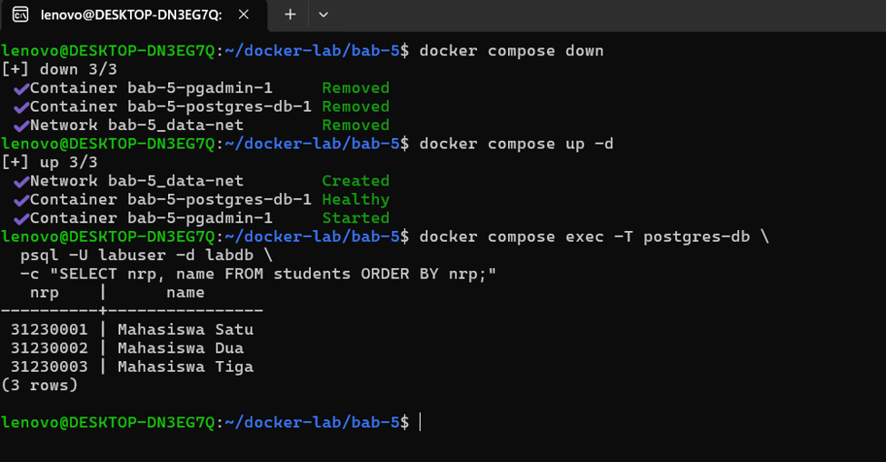

```bash
docker compose down
docker compose up -d

docker compose exec -T postgres-db \
  psql -U labuser -d labdb \
  -c "SELECT nrp, name FROM students ORDER BY nrp;"
```

Ketiga record tetap tersedia karena `docker compose down` tanpa `-v` mempertahankan named volume.

## 13. Buat script backup

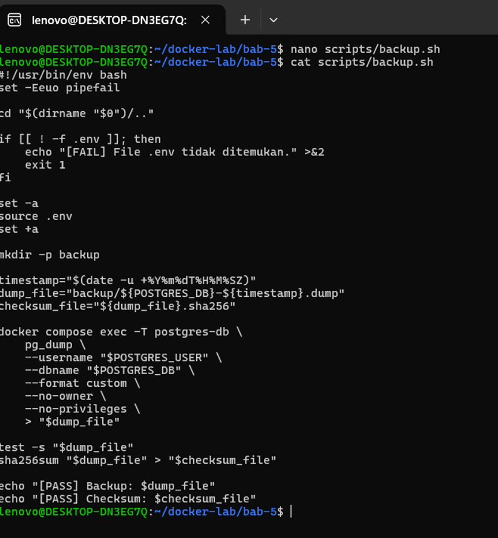

Simpan script pada `scripts/backup.sh`. Script menjalankan `pg_dump` dalam custom format, membuat file dump, lalu menghitung SHA-256.

```bash
docker compose exec -T postgres-db \
  pg_dump --username "$POSTGRES_USER" \
  --dbname "$POSTGRES_DB" \
  --format custom \
  --no-owner \
  --no-privileges
```

## 14. Buat script restore test

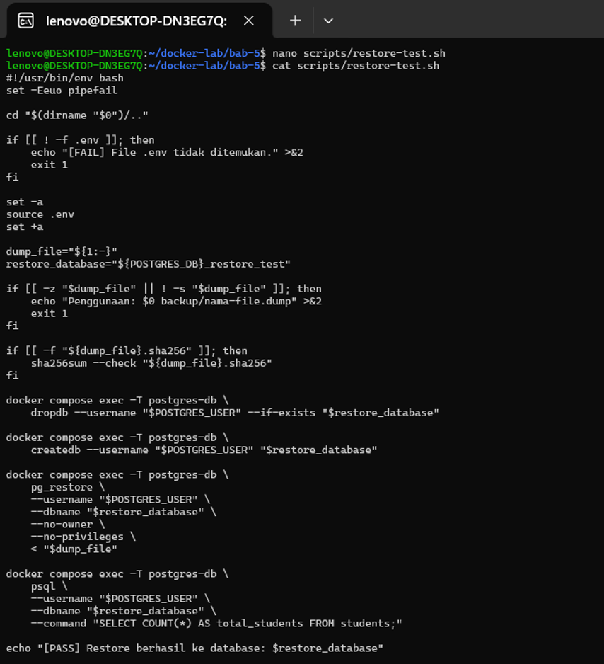

Simpan script pada `scripts/restore-test.sh`. Script memeriksa checksum, membuat ulang database `labdb_restore_test`, lalu memulihkan dump ke database tersebut - bukan ke database sumber.

## 15. Jadikan script dapat dijalankan

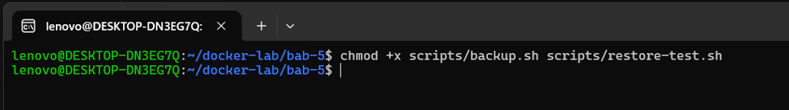

```bash
chmod +x scripts/backup.sh scripts/restore-test.sh
```

## 16. Jalankan backup dan periksa checksum

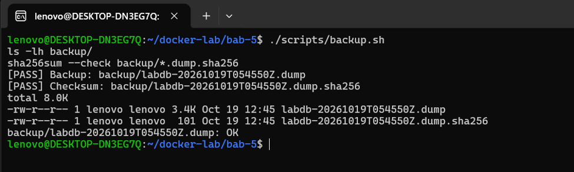

```bash
./scripts/backup.sh
ls -lh backup/
sha256sum --check backup/*.dump.sha256
```

File dump dibuat dan checksum berstatus `OK`. Dump yang berhasil dibuat belum membuktikan bahwa restore berhasil.

## 17. Uji restore

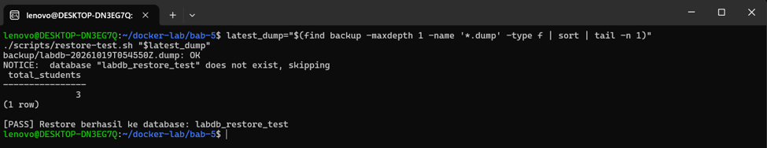

```bash
latest_dump="$(find backup -maxdepth 1 -name '*.dump' -type f | sort | tail -n 1)"
./scripts/restore-test.sh "$latest_dump"
```

Script melaporkan jumlah data yang berhasil dipulihkan ke database uji.

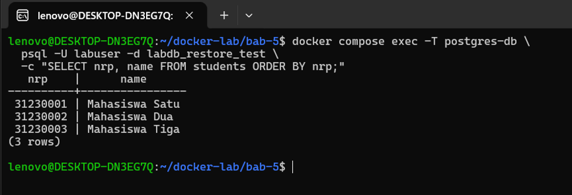

```bash
docker compose exec -T postgres-db \
  psql -U labuser -d labdb_restore_test \
  -c "SELECT nrp, name FROM students ORDER BY nrp;"
```

Ketiga record terlihat pada database hasil restore. Ini membuktikan dump dapat dipulihkan dan datanya sesuai.

## 18. Cleanup

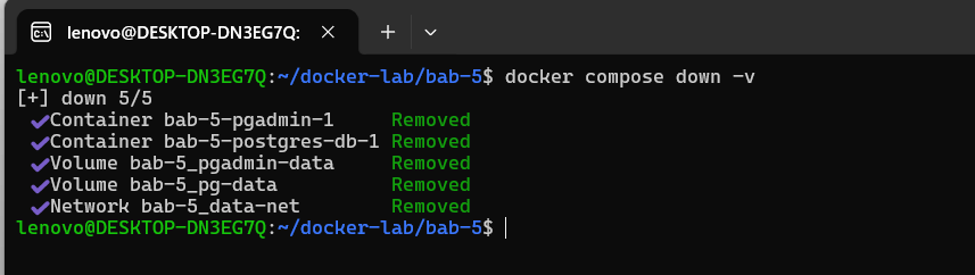

```bash
docker compose down -v
```

**Perhatian:** `-v` menghapus volume PostgreSQL dan pgAdmin, termasuk seluruh data database. Untuk menghentikan container tanpa menghapus data, gunakan:

```bash
docker compose down
```

## Hasil

- PostgreSQL berjalan dengan named volume dan healthcheck.
- Init script membuat tabel serta data awal.
- pgAdmin berhasil terhubung ke PostgreSQL.
- Data bertahan setelah container dibuat ulang.
- Backup custom format memiliki checksum valid.
- Restore berhasil diuji pada database terpisah.
- `docker compose down -v` menghapus seluruh data pada volume proyek.