# Praktikum Bab 6 - Centralized Logging dengan Fluent Bit, PostgreSQL, dan Grafana

Praktikum dijalankan di Ubuntu dari `~/docker-lab/bab-6`. Alur yang dibangun: tiga container generator mengirim log melalui Docker logging driver `fluentd` ke Fluent Bit, lalu Fluent Bit menyimpannya ke PostgreSQL. Log dianalisis dengan SQL dan divisualisasikan di Grafana.

```
generator-auth / generator-api / generator-worker
        | (logging driver fluentd, 127.0.0.1:24224)
        v
    Fluent Bit  --(buffer filesystem)-->  PostgreSQL (logs.fluentbit)
                                                |
                                                v
                                             Grafana
```

## 1. Siapkan direktori

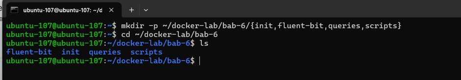

```
mkdir -p ~/docker-lab/bab-6/{init,fluent-bit,queries,scripts}
cd ~/docker-lab/bab-6
ls
```

Brace expansion `{a,b,c}` dipecah shell menjadi beberapa argumen, sedangkan `-p` membuat direktori induk bila belum ada dan tidak gagal bila direktori sudah ada. Tanggung jawab dipisah: `fluent-bit` untuk konfigurasi collector, `init` untuk skrip inisialisasi database, `queries` untuk query analisis, dan `scripts` untuk skrip uji.

## 2. Buat template konfigurasi

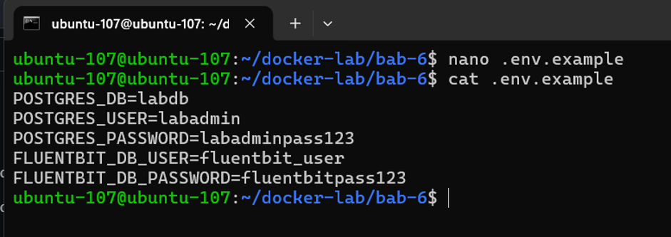

Buat `.env.example` berisi lima variabel: database, user dan password admin, serta user dan password ingest Fluent Bit.

```
POSTGRES_DB=labdb
POSTGRES_USER=labadmin
POSTGRES_PASSWORD=ganti-dengan-password-lab
FLUENTBIT_DB_USER=fluentbit_user
FLUENTBIT_DB_PASSWORD=ganti-dengan-password-lab
```

Gunakan `cat` setelah menyimpan untuk memastikan isi file benar-benar tersimpan.

## 3. Buat konfigurasi lokal

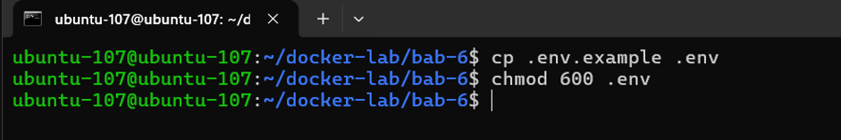

```
cp .env.example .env
chmod 600 .env
```

Template disalin menjadi `.env` yang dipakai Compose. `chmod 600` membatasi akses file ke pemiliknya.

## 4. Abaikan file rahasia, log, dan laporan

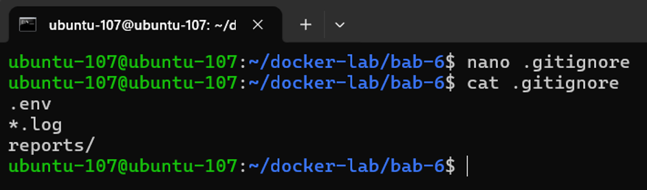

Buat `.gitignore`:

```
.env
*.log
reports/
```

Dengan aturan ini password lab, file log hasil praktikum, dan direktori laporan tidak ikut ter-commit.

## 5. Tulis `compose.yaml`

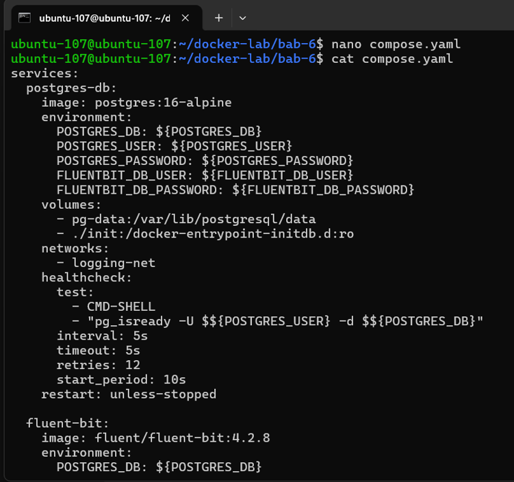

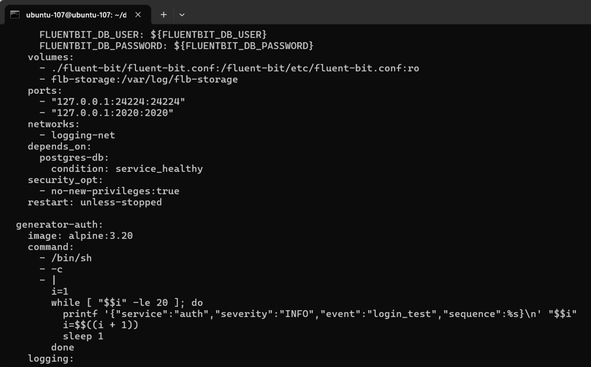

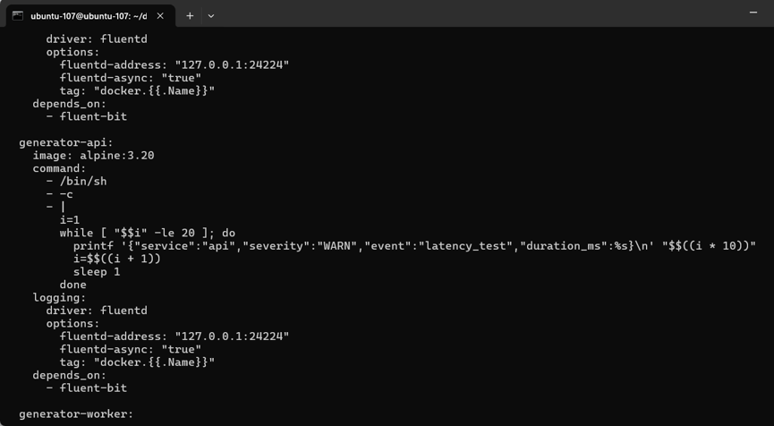

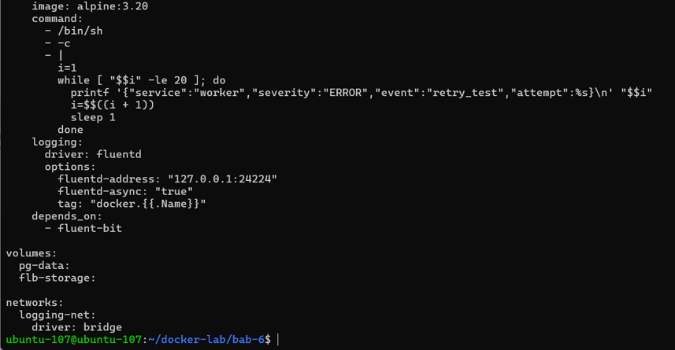

```yaml
services:
  postgres-db:
    image: postgres:16-alpine
    environment:
      POSTGRES_DB: ${POSTGRES_DB}
      POSTGRES_USER: ${POSTGRES_USER}
      POSTGRES_PASSWORD: ${POSTGRES_PASSWORD}
      FLUENTBIT_DB_USER: ${FLUENTBIT_DB_USER}
      FLUENTBIT_DB_PASSWORD: ${FLUENTBIT_DB_PASSWORD}
    volumes:
      - pg-data:/var/lib/postgresql/data
      - ./init:/docker-entrypoint-initdb.d:ro
    networks:
      - logging-net
    healthcheck:
      test:
        - CMD-SHELL
        - "pg_isready -U $${POSTGRES_USER} -d $${POSTGRES_DB}"
      interval: 5s
      timeout: 5s
      retries: 12
      start_period: 10s
    restart: unless-stopped

  fluent-bit:
    image: fluent/fluent-bit:4.2.8
    environment:
      POSTGRES_DB: ${POSTGRES_DB}
      FLUENTBIT_DB_USER: ${FLUENTBIT_DB_USER}
      FLUENTBIT_DB_PASSWORD: ${FLUENTBIT_DB_PASSWORD}
    volumes:
      - ./fluent-bit/fluent-bit.conf:/fluent-bit/etc/fluent-bit.conf:ro
      - flb-storage:/var/log/flb-storage
    ports:
      - "127.0.0.1:24224:24224"
      - "127.0.0.1:2020:2020"
    networks:
      - logging-net
    depends_on:
      postgres-db:
        condition: service_healthy
    security_opt:
      - no-new-privileges:true
    restart: unless-stopped

  generator-auth:
    image: alpine:3.20
    command:
      - /bin/sh
      - -c
      - |
        i=1
        while [ "$$i" -le 20 ]; do
          printf '{"service":"auth","severity":"INFO","event":"login_test","sequence":%s}\n' "$$i"
          i=$$((i + 1))
          sleep 1
        done
    logging:
      driver: fluentd
      options:
        fluentd-address: "127.0.0.1:24224"
        fluentd-async: "true"
        tag: "docker.{{.Name}}"
    depends_on:
      - fluent-bit

  # generator-api: severity WARN, event latency_test, duration_ms = i * 10
  # generator-worker: severity ERROR, event retry_test, attempt = i
  # Keduanya memakai blok command, logging, dan depends_on yang sama dengan generator-auth.

volumes:
  pg-data:
  flb-storage:

networks:
  logging-net:
    driver: bridge
```

Penjelasan bagian penting:

- **Interpolasi `${...}`**: lima environment PostgreSQL diisi dari `.env`.
- **`pg-data` (named volume)**: data tabel bertahan saat container dibuat ulang.
- **`./init:/docker-entrypoint-initdb.d:ro`**: skrip init dipasang read-only. Image PostgreSQL menjalankan file `.sh` dan `.sql` di direktori ini **hanya saat data directory masih kosong**, sehingga mengedit skrip tidak berefek pada volume yang sudah terisi.
- **healthcheck**: `pg_isready` dijalankan tiap 5 detik. Kegagalan pada 10 detik pertama (`start_period`) tidak dihitung, dan container dinyatakan `unhealthy` setelah 12 kegagalan berturut-turut. Tanda `$$` mencegah Compose menginterpolasi variabel di host.
- **`restart: unless-stopped`**: container hidup lagi setelah crash atau reboot host, kecuali dihentikan manual.
- **`flb-storage`**: volume buffer filesystem, sumber utama ketahanan saat PostgreSQL mati sementara.
- **`127.0.0.1:24224:24224` dan `127.0.0.1:2020:2020`**: port hanya dibuka di loopback host, tidak di semua interface.
- **`depends_on: condition: service_healthy`**: Fluent Bit baru dimulai setelah healthcheck PostgreSQL lulus.
- **`no-new-privileges:true`**: proses di dalam container tidak dapat menaikkan hak lewat binary setuid.
- **Generator**: loop `while` 20 kali mencetak satu baris JSON ke stdout, menaikkan counter, lalu `sleep 1`. Setelah sekitar 20 detik container berhenti dengan status `Exited (0)`. Total event yang diharapkan: 3 x 20 = **60 record**.
- **Logging driver**: `driver: fluentd` mengirim stdout ke collector; `fluentd-address` menunjuk port yang dipublikasikan di host; `fluentd-async: "true"` (ditulis sebagai string) membuat Docker mencoba koneksi di latar belakang agar container tidak langsung gagal bila collector belum siap; `tag: "docker.{{.Name}}"` menghasilkan tag seperti `docker.bab-6-generator-auth-1` sehingga `GROUP BY tag` dapat membedakan sumber log.
- **`depends_on: - fluent-bit`** pada generator hanya menunggu collector *dimulai*, bukan siap menerima koneksi. Kesiapan sebenarnya ditangani `fluentd-async`.
- **Network `logging-net`** bertipe bridge, sehingga Fluent Bit dapat menjangkau `postgres-db` lewat nama service.

## 6. Buat skrip inisialisasi database

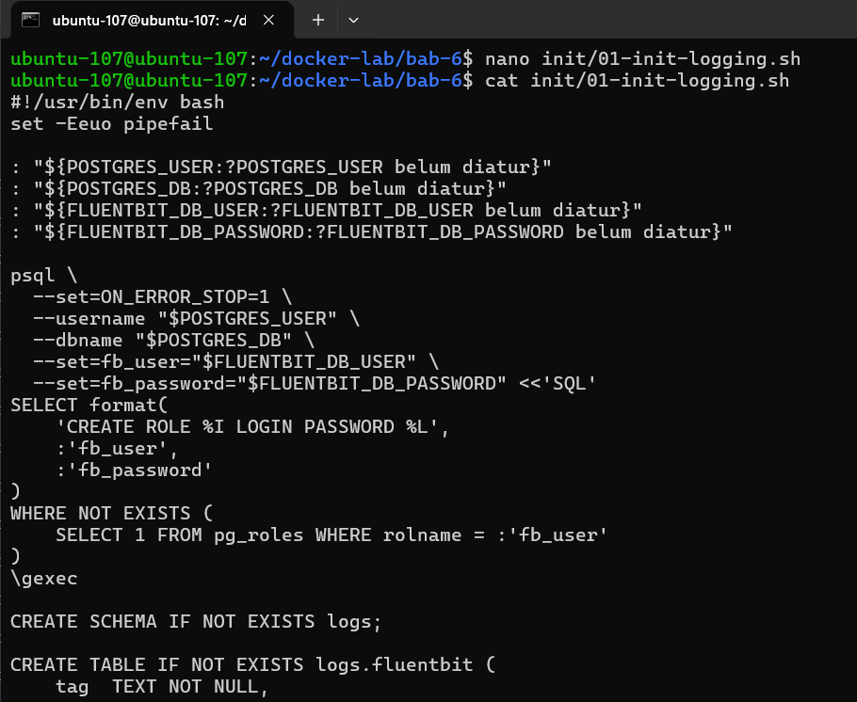

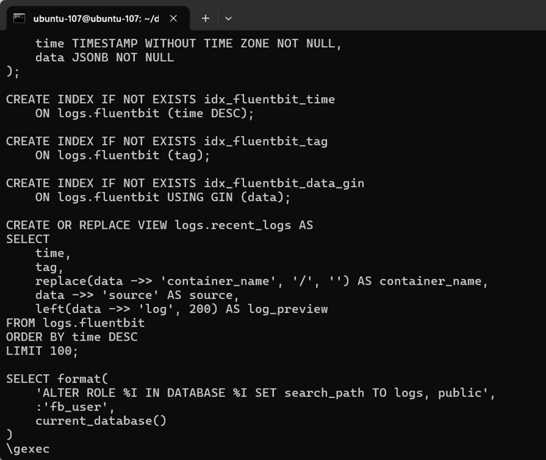

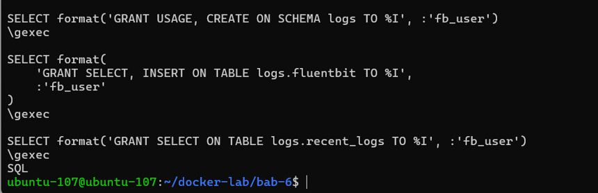

Simpan sebagai `init/01-init-logging.sh`:

```bash
#!/usr/bin/env bash
set -Eeuo pipefail

: "${POSTGRES_USER:?POSTGRES_USER belum diatur}"
: "${POSTGRES_DB:?POSTGRES_DB belum diatur}"
: "${FLUENTBIT_DB_USER:?FLUENTBIT_DB_USER belum diatur}"
: "${FLUENTBIT_DB_PASSWORD:?FLUENTBIT_DB_PASSWORD belum diatur}"

psql \
  --set=ON_ERROR_STOP=1 \
  --username "$POSTGRES_USER" \
  --dbname "$POSTGRES_DB" \
  --set=fb_user="$FLUENTBIT_DB_USER" \
  --set=fb_password="$FLUENTBIT_DB_PASSWORD" <<'SQL'
SELECT format(
    'CREATE ROLE %I LOGIN PASSWORD %L',
    :'fb_user',
    :'fb_password'
)
WHERE NOT EXISTS (
    SELECT 1 FROM pg_roles WHERE rolname = :'fb_user'
)
\gexec

CREATE SCHEMA IF NOT EXISTS logs;

CREATE TABLE IF NOT EXISTS logs.fluentbit (
    tag  TEXT NOT NULL,
    time TIMESTAMP WITHOUT TIME ZONE NOT NULL,
    data JSONB NOT NULL
);

CREATE INDEX IF NOT EXISTS idx_fluentbit_time
    ON logs.fluentbit (time DESC);

CREATE INDEX IF NOT EXISTS idx_fluentbit_tag
    ON logs.fluentbit (tag);

CREATE INDEX IF NOT EXISTS idx_fluentbit_data_gin
    ON logs.fluentbit USING GIN (data);

CREATE OR REPLACE VIEW logs.recent_logs AS
SELECT
    time,
    tag,
    replace(data ->> 'container_name', '/', '') AS container_name,
    data ->> 'source' AS source,
    left(data ->> 'log', 200) AS log_preview
FROM logs.fluentbit
ORDER BY time DESC
LIMIT 100;

SELECT format(
    'ALTER ROLE %I IN DATABASE %I SET search_path TO logs, public',
    :'fb_user',
    current_database()
)
\gexec

SELECT format('GRANT USAGE, CREATE ON SCHEMA logs TO %I', :'fb_user')
\gexec

SELECT format(
    'GRANT SELECT, INSERT ON TABLE logs.fluentbit TO %I',
    :'fb_user'
)
\gexec

SELECT format('GRANT SELECT ON TABLE logs.recent_logs TO %I', :'fb_user')
\gexec
SQL
```

Beri izin eksekusi:

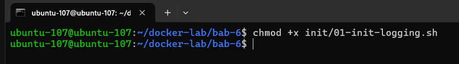

```
chmod +x init/01-init-logging.sh
```

Penjelasan:

- `#!/usr/bin/env bash` memilih Bash dari `PATH`, bukan path absolut yang bisa berbeda antar distro.
- `set -Eeuo pipefail` menghentikan skrip pada error, variabel yang belum diisi, dan kegagalan di tengah pipeline.
- `: "${VAR:?pesan}"` menghentikan skrip lebih awal dengan pesan jelas bila variabel kosong, sehingga role tidak dibuat dengan password kosong.
- `--set=ON_ERROR_STOP=1` membuat `psql` keluar dengan status gagal pada error SQL pertama, sehingga inisialisasi tidak berlanjut dengan schema setengah jadi.
- `--set=fb_user=...` mengirim nilai sebagai variabel psql yang dipakai sebagai `:'fb_user'` di dalam SQL.
- `<<'SQL'` adalah heredoc dengan quote, sehingga `$` dan backtick tidak diekspansi oleh shell.
- Role dibuat lewat `SELECT format('CREATE ROLE %I LOGIN PASSWORD %L', ...)` yang dieksekusi `\gexec`, hanya jika belum ada di `pg_roles`. Pola ini idempoten. `%I` mengutip identifier dan `%L` mengutip literal, sehingga karakter khusus pada password tidak merusak sintaks.
- **Schema `logs`** memisahkan tabel log dari objek aplikasi lain.
- **Tabel `logs.fluentbit`** memiliki kolom `tag`, `time`, dan `data` (JSONB). Ketiganya mengikuti kontrak plugin `out_pgsql`.
- **Tiga indeks**: `idx_fluentbit_time` (log terbaru), `idx_fluentbit_tag` (pengelompokan per sumber), dan `idx_fluentbit_data_gin` (pencarian di dalam JSON).
- **View `logs.recent_logs`** menampilkan 100 record terakhir dan menjadi kontrol akses baca yang sempit untuk akun ingest.
- **`ALTER ROLE ... SET search_path TO logs, public`** membuat plugin menemukan tabel `fluentbit` tanpa menyebut schema. Tanpa ini plugin dapat gagal dengan `relation "fluentbit" does not exist`.
- **Grant**: `USAGE, CREATE` pada schema `logs`, `SELECT, INSERT` pada `logs.fluentbit`, dan `SELECT` pada view.
- Bit eksekusi tidak selalu wajib karena image PostgreSQL menjalankan file `.sh` di `docker-entrypoint-initdb.d` lewat bash, tetapi tetap diberikan agar konsisten dan bisa diuji manual.

## 7. Konfigurasikan Fluent Bit

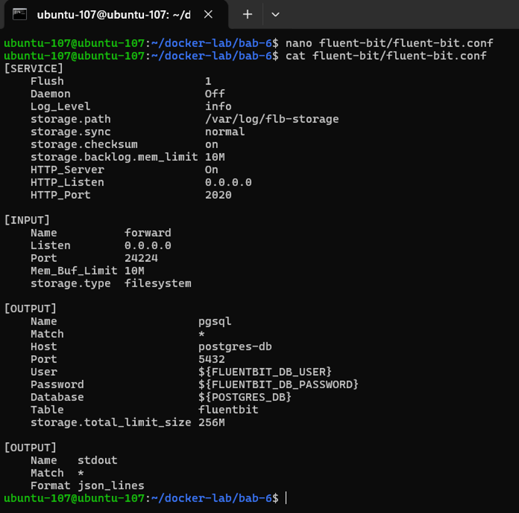

Simpan sebagai `fluent-bit/fluent-bit.conf`:

```
[SERVICE]
    Flush                     1
    Daemon                    Off
    Log_Level                 info
    storage.path              /var/log/flb-storage
    storage.sync              normal
    storage.checksum          on
    storage.backlog.mem_limit 10M
    HTTP_Server               On
    HTTP_Listen               0.0.0.0
    HTTP_Port                 2020

[INPUT]
    Name          forward
    Listen        0.0.0.0
    Port          24224
    Mem_Buf_Limit 10M
    storage.type  filesystem

[OUTPUT]
    Name                      pgsql
    Match                     *
    Host                      postgres-db
    Port                      5432
    User                      ${FLUENTBIT_DB_USER}
    Password                  ${FLUENTBIT_DB_PASSWORD}
    Database                  ${POSTGRES_DB}
    Table                     fluentbit
    storage.total_limit_size  256M

[OUTPUT]
    Name   stdout
    Match  *
    Format json_lines
```

| Bagian | Pengaturan | Fungsi |
|---|---|---|
| SERVICE | `Flush 1` | Mengirim data secara berkala setiap 1 detik. |
| SERVICE | `Daemon Off` | Berjalan di foreground, sesuai pola container Docker. |
| SERVICE | `storage.path` | Lokasi buffer filesystem, dipertahankan oleh volume `flb-storage`. |
| SERVICE | `storage.checksum on` | Mendeteksi kerusakan data buffer. |
| SERVICE | `storage.backlog.mem_limit 10M` | Membatasi memori untuk memuat backlog dari penyimpanan. |
| SERVICE | `HTTP_Server On`, port 2020 | Endpoint health dan metrics. Akses dari host tetap dibatasi ke `127.0.0.1` oleh Compose. |
| INPUT | `forward`, port 24224 | Menerima log dari Docker logging driver `fluentd`. |
| INPUT | `storage.type filesystem` | Data dapat mengantre di disk saat output bermasalah. |
| OUTPUT | `pgsql` | Mengirim record ke PostgreSQL. Host `postgres-db` adalah nama service Compose, bukan `localhost`. Schema `logs` ditemukan lewat `search_path` role. |
| OUTPUT | `stdout` | Menulis record `json_lines` ke log Fluent Bit untuk troubleshooting; dapat menambah volume log container. |

## 8. Tulis query analisis

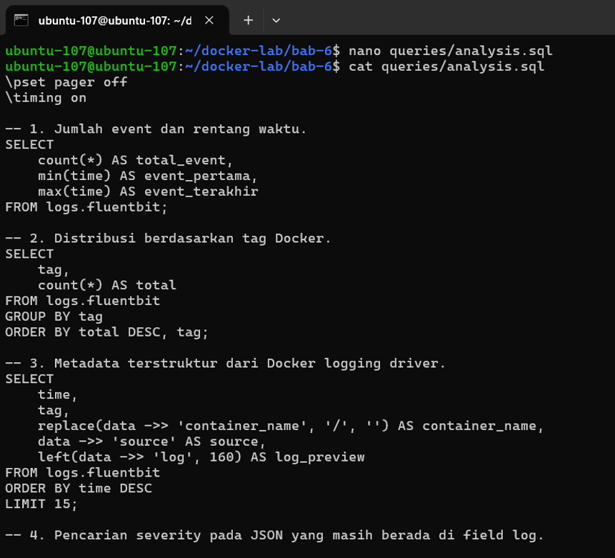

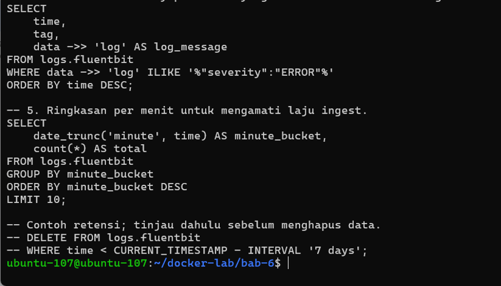

Simpan sebagai `queries/analysis.sql`:

```sql
\pset pager off
\timing on

-- 1. Jumlah event dan rentang waktu.
SELECT
    count(*) AS total_event,
    min(time) AS event_pertama,
    max(time) AS event_terakhir
FROM logs.fluentbit;

-- 2. Distribusi berdasarkan tag Docker.
SELECT
    tag,
    count(*) AS total
FROM logs.fluentbit
GROUP BY tag
ORDER BY total DESC, tag;

-- 3. Metadata terstruktur dari Docker logging driver.
SELECT
    time,
    tag,
    replace(data ->> 'container_name', '/', '') AS container_name,
    data ->> 'source' AS source,
    left(data ->> 'log', 160) AS log_preview
FROM logs.fluentbit
ORDER BY time DESC
LIMIT 15;

-- 4. Pencarian severity pada JSON yang masih berada di field log.
SELECT
    time,
    tag,
    data ->> 'log' AS log_message
FROM logs.fluentbit
WHERE data ->> 'log' ILIKE '%"severity":"ERROR"%'
ORDER BY time DESC;

-- 5. Ringkasan per menit untuk mengamati laju ingest.
SELECT
    date_trunc('minute', time) AS minute_bucket,
    count(*) AS total
FROM logs.fluentbit
GROUP BY minute_bucket
ORDER BY minute_bucket DESC
LIMIT 10;

-- Contoh retensi; tinjau dahulu sebelum menghapus data.
-- DELETE FROM logs.fluentbit
-- WHERE time < CURRENT_TIMESTAMP - INTERVAL '7 days';
```

Fungsi elemen utama: `\pset pager off` mematikan pager, `\timing on` menampilkan durasi query, `data ->> 'field'` mengambil field JSONB sebagai teks, `ILIKE` mencari teks tanpa membedakan huruf besar-kecil, dan `date_trunc('minute', time)` mengelompokkan waktu per menit.

## 9. Buat skrip pembangkit log

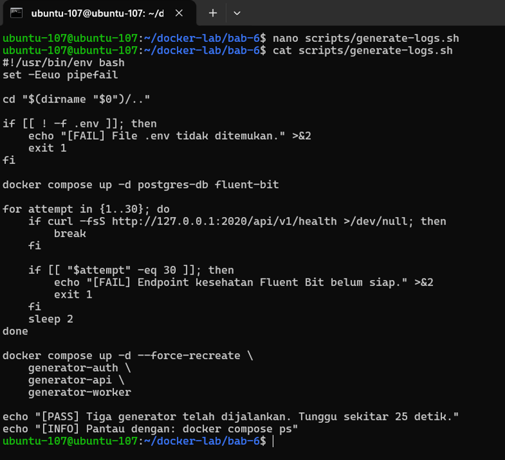

Simpan sebagai `scripts/generate-logs.sh`:

```bash
#!/usr/bin/env bash
set -Eeuo pipefail

cd "$(dirname "$0")/.."

if [[ ! -f .env ]]; then
    echo "[FAIL] File .env tidak ditemukan." >&2
    exit 1
fi

docker compose up -d postgres-db fluent-bit

for attempt in {1..30}; do
    if curl -fsS http://127.0.0.1:2020/api/v1/health >/dev/null; then
        break
    fi

    if [[ "$attempt" -eq 30 ]]; then
        echo "[FAIL] Endpoint kesehatan Fluent Bit belum siap." >&2
        exit 1
    fi
    sleep 2
done

docker compose up -d --force-recreate \
    generator-auth \
    generator-api \
    generator-worker

echo "[PASS] Tiga generator telah dijalankan. Tunggu sekitar 25 detik."
echo "[INFO] Pantau dengan: docker compose ps"
```

Urutan kerja: skrip berhenti saat ada kegagalan, pindah ke direktori utama Bab 6 lewat `cd "$(dirname "$0")/.."`, memeriksa `.env`, menjalankan database dan collector, menunggu endpoint health Fluent Bit (maksimal 30 percobaan, jeda 2 detik), lalu membuat ulang ketiga generator agar masing-masing mengirim rangkaian event dari awal. `curl -fsS` menandai respons HTTP error sebagai gagal, tetapi tetap menampilkan pesan error.

## 10. Buat skrip uji buffering

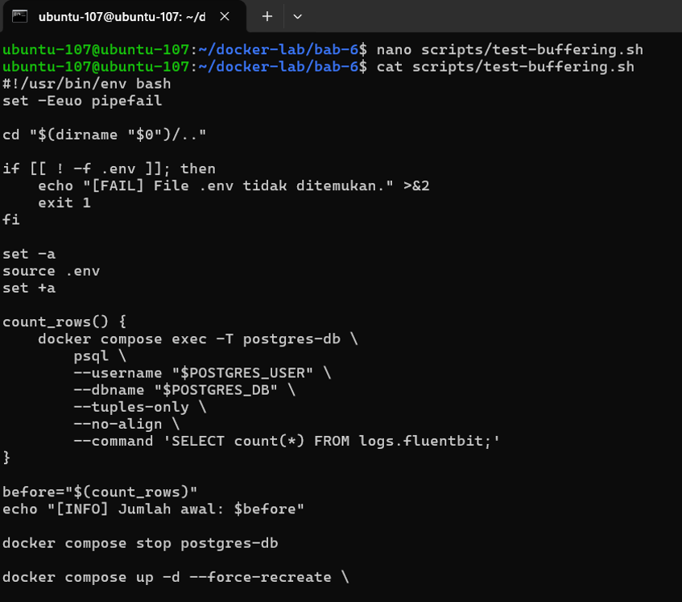

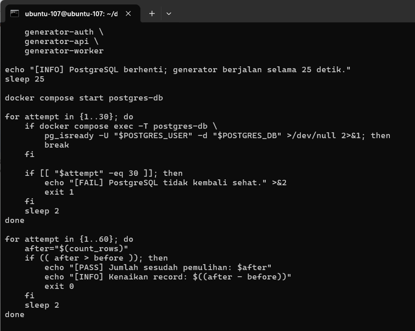

Simpan sebagai `scripts/test-buffering.sh`:

```bash
#!/usr/bin/env bash
set -Eeuo pipefail

cd "$(dirname "$0")/.."

if [[ ! -f .env ]]; then
    echo "[FAIL] File .env tidak ditemukan." >&2
    exit 1
fi

set -a
source .env
set +a

count_rows() {
    docker compose exec -T postgres-db \
        psql \
        --username "$POSTGRES_USER" \
        --dbname "$POSTGRES_DB" \
        --tuples-only \
        --no-align \
        --command 'SELECT count(*) FROM logs.fluentbit;'
}

before="$(count_rows)"
echo "[INFO] Jumlah awal: $before"

docker compose stop postgres-db

docker compose up -d --force-recreate \
    generator-auth \
    generator-api \
    generator-worker

echo "[INFO] PostgreSQL berhenti; generator berjalan selama 25 detik."
sleep 25

docker compose start postgres-db

for attempt in {1..30}; do
    if docker compose exec -T postgres-db \
        pg_isready -U "$POSTGRES_USER" -d "$POSTGRES_DB" >/dev/null 2>&1; then
        break
    fi

    if [[ "$attempt" -eq 30 ]]; then
        echo "[FAIL] PostgreSQL tidak kembali sehat." >&2
        exit 1
    fi
    sleep 2
done

for attempt in {1..60}; do
    after="$(count_rows)"
    if (( after > before )); then
        echo "[PASS] Jumlah sesudah pemulihan: $after"
        echo "[INFO] Kenaikan record: $((after - before))"
        exit 0
    fi
    sleep 2
done

echo "[FAIL] Tidak ada record baru setelah PostgreSQL pulih." >&2
echo "[INFO] Periksa: docker compose logs --tail 200 fluent-bit" >&2
exit 1
```

Urutan pengujian: pastikan `.env` ada, muat variabel dengan `set -a` / `source .env` / `set +a`, catat jumlah baris awal lewat `count_rows`, hentikan PostgreSQL, buat ulang generator, nyalakan kembali PostgreSQL dan periksa dengan `pg_isready`, lalu bandingkan jumlah baris secara berkala. Bila jumlah bertambah, skrip menampilkan `[PASS]`. Opsi `docker compose exec -T` menjalankan perintah tanpa terminal interaktif, sedangkan `--tuples-only` dan `--no-align` membuat hasil `count(*)` mudah dibandingkan secara numerik di Bash.

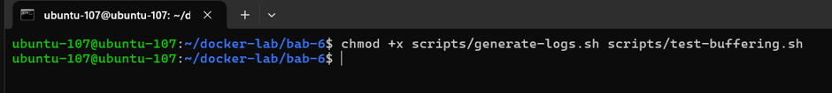

```
chmod +x scripts/generate-logs.sh scripts/test-buffering.sh
```

Perintah ini hanya mengubah permission; skrip belum dijalankan.

## 11. Validasi sintaks dan konfigurasi

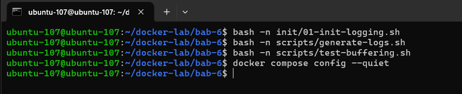

```
bash -n init/01-init-logging.sh
bash -n scripts/generate-logs.sh
bash -n scripts/test-buffering.sh
docker compose config --quiet
```

Keempat perintah selesai tanpa error. `bash -n` hanya memeriksa sintaks dan tidak membuktikan skrip berperilaku benar. `docker compose config --quiet` menunjukkan konfigurasi Compose diterima tanpa error sintaks atau interpolasi.

## 12. Jalankan PostgreSQL dan Fluent Bit

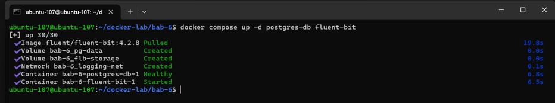

```
docker compose up -d postgres-db fluent-bit
```

Image Fluent Bit diunduh, volume dan network dibuat, PostgreSQL mencapai status `Healthy`, dan container Fluent Bit berjalan.

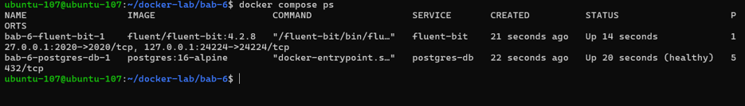

```
docker compose ps
```

PostgreSQL `healthy` dan Fluent Bit `Up`.

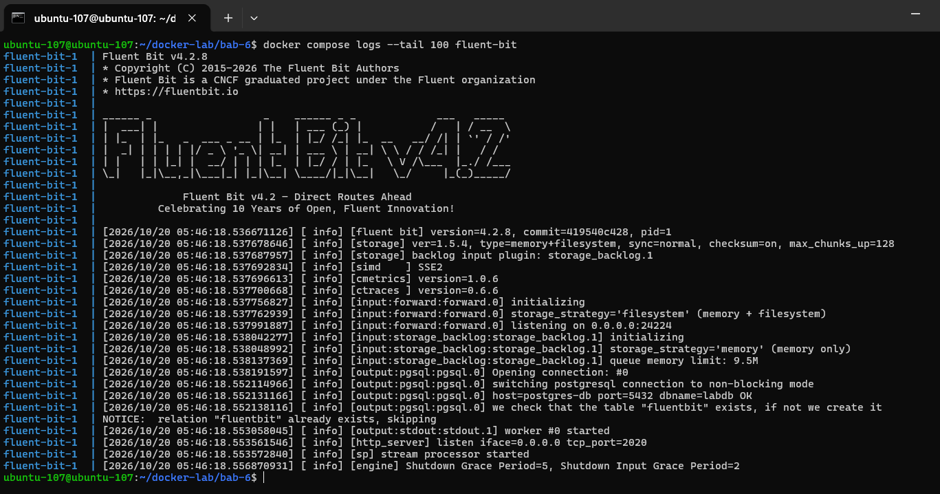

```
docker compose logs --tail 100 fluent-bit
```

Log menunjukkan input Forward, output PostgreSQL, output stdout, dan HTTP server dimulai. Pesan bahwa tabel `fluentbit` sudah ada lalu dilewati adalah perilaku normal karena tabel sudah dibuat oleh skrip init.

## 13. Hasilkan log uji

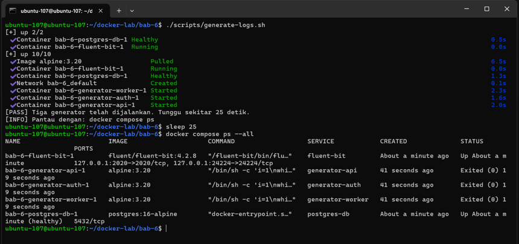

```
./scripts/generate-logs.sh
sleep 25
docker compose ps --all
```

Setiap generator mengirim 20 event, sehingga target uji adalah sekitar **60 event**. Setelah 25 detik, PostgreSQL tetap `healthy`, Fluent Bit tetap `Up`, dan ketiga generator berstatus `Exited (0)`.

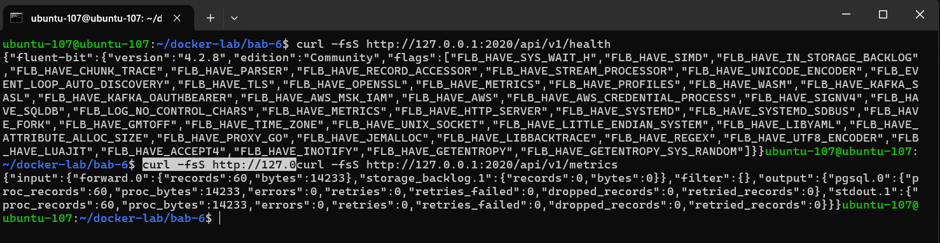

```
curl -fsS http://127.0.0.1:2020/api/v1/health
curl -fsS http://127.0.0.1:2020/api/v1/metrics
```

Metrics mencatat sekitar 60 record pada input Forward serta output PostgreSQL dan stdout, dengan `errors`, `retries`, dan `dropped_records` bernilai 0. Ini konsisten dengan pipeline yang berhasil, tetapi query SQL tetap diperlukan untuk memastikan record benar-benar tersimpan.

## 14. Muat variabel dan jalankan query analisis

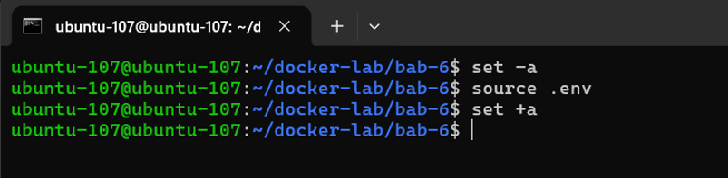

```
set -a
source .env
set +a
```

`set -a` mengekspor variabel yang dimuat agar terbaca oleh proses berikutnya, termasuk `psql`; `set +a` mematikannya kembali. `.env` harus dipercaya karena `source` menjalankannya sebagai perintah shell.

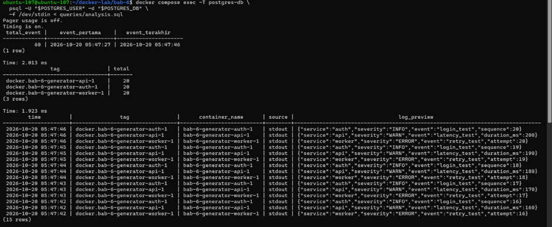

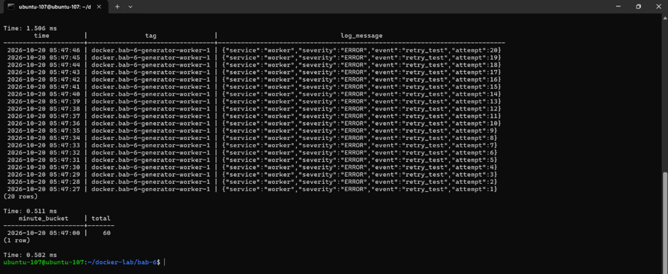

```
docker compose exec -T postgres-db \
  psql -U "$POSTGRES_USER" -d "$POSTGRES_DB" \
  -f /dev/stdin < queries/analysis.sql
```

Hasil: total 60 event dengan 20 event per tag (`docker.bab-6-generator-api-1`, `docker.bab-6-generator-auth-1`, `docker.bab-6-generator-worker-1`), 20 baris log `severity":"ERROR"` dari worker, dan 60 event berada pada satu menit yang sama.

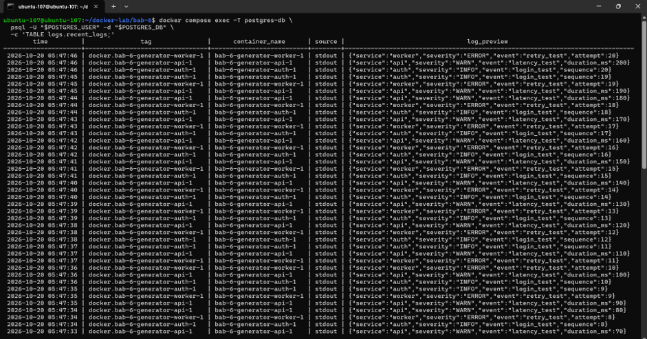

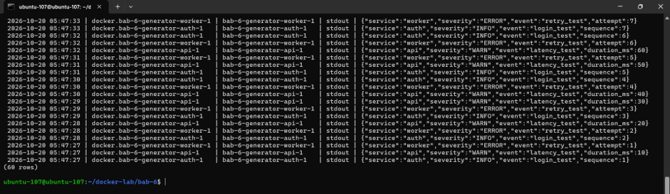

```
docker compose exec -T postgres-db \
  psql -U "$POSTGRES_USER" -d "$POSTGRES_DB" \
  -c 'TABLE logs.recent_logs;'
```

View dibatasi 100 record, tetapi hasilnya berisi 60 baris karena baru 60 log yang tersedia.

## 15. Uji buffering

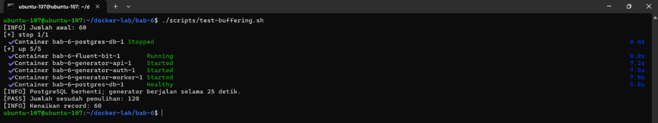

```
./scripts/test-buffering.sh
```

Jumlah awal 60, jumlah sesudah pemulihan 120, sehingga naik 60 record dan skrip menampilkan `[PASS]`.

> **Catatan:** pada output tahap `up` di screenshot, container `postgres-db-1` muncul kembali berstatus `Healthy`. Karena `fluent-bit` memiliki `depends_on: postgres-db` dengan `service_healthy`, perintah `docker compose up -d --force-recreate generator-...` dapat menyalakan ulang PostgreSQL sebagai dependensi. Akibatnya, uji ini belum tentu membuktikan buffering saat database benar-benar mati selama 25 detik. Untuk mengisolasi gangguan, tambahkan `--no-deps` pada perintah `up` generator di dalam skrip.

## 16. Tambahkan Grafana

### 16.1 Tambah variabel `.env`

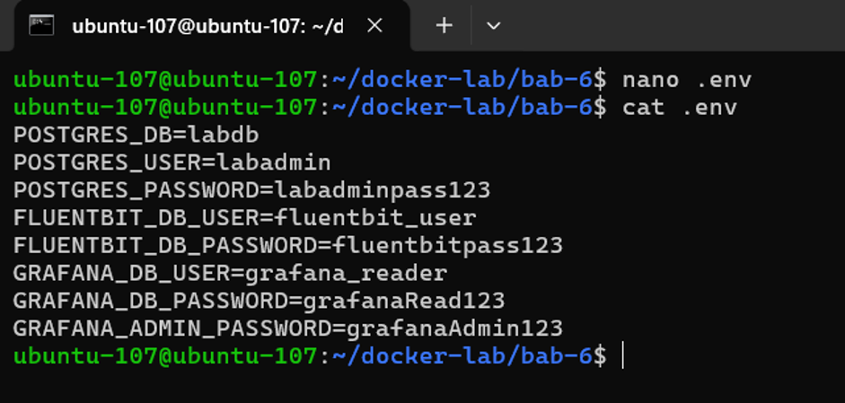

Tambahkan tiga variabel berikut ke `.env` (dan templatnya):

```
GRAFANA_DB_USER=grafana_reader
GRAFANA_DB_PASSWORD=ganti-dengan-password-lab
GRAFANA_ADMIN_PASSWORD=ganti-dengan-password-lab
```

`GRAFANA_DB_USER` dan `GRAFANA_DB_PASSWORD` dipakai untuk akun PostgreSQL yang menjadi data source Grafana, sedangkan `GRAFANA_ADMIN_PASSWORD` adalah password administrator Grafana.

### 16.2 Buat role pembaca

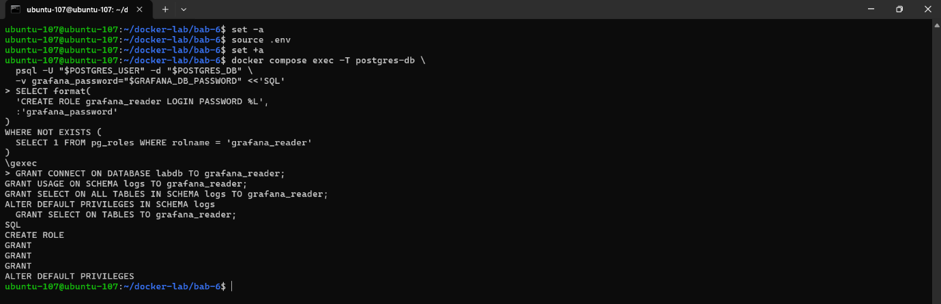

```
set -a
source .env
set +a

docker compose exec -T postgres-db \
  psql -U "$POSTGRES_USER" -d "$POSTGRES_DB" \
  -v grafana_password="$GRAFANA_DB_PASSWORD" <<'SQL'
SELECT format(
  'CREATE ROLE grafana_reader LOGIN PASSWORD %L',
  :'grafana_password'
)
WHERE NOT EXISTS (
  SELECT 1 FROM pg_roles WHERE rolname = 'grafana_reader'
)
\gexec
GRANT CONNECT ON DATABASE labdb TO grafana_reader;
GRANT USAGE ON SCHEMA logs TO grafana_reader;
GRANT SELECT ON ALL TABLES IN SCHEMA logs TO grafana_reader;
ALTER DEFAULT PRIVILEGES IN SCHEMA logs
  GRANT SELECT ON TABLES TO grafana_reader;
SQL
```

Output yang muncul: `CREATE ROLE`, tiga `GRANT`, dan `ALTER DEFAULT PRIVILEGES`.

- `-v` mengirim password sebagai variabel psql, lalu `format(... %L ...)` memasukkannya sebagai literal SQL yang dikutip dengan benar.
- Role dibuat hanya jika belum ada di `pg_roles`; `\gexec` menjalankan SQL hasil `SELECT format(...)`.
- `GRANT CONNECT` mengizinkan koneksi ke database, `GRANT USAGE ON SCHEMA logs` mengizinkan akses ke objek di schema, dan `GRANT SELECT ON ALL TABLES` memberi hak baca pada tabel yang sudah ada.
- `ALTER DEFAULT PRIVILEGES` memberi hak baca pada tabel yang dibuat kemudian **oleh role yang menjalankan perintah ini**. Pengaturan ini tidak otomatis berlaku untuk tabel yang dibuat role lain.

### 16.3 Tambah service Grafana

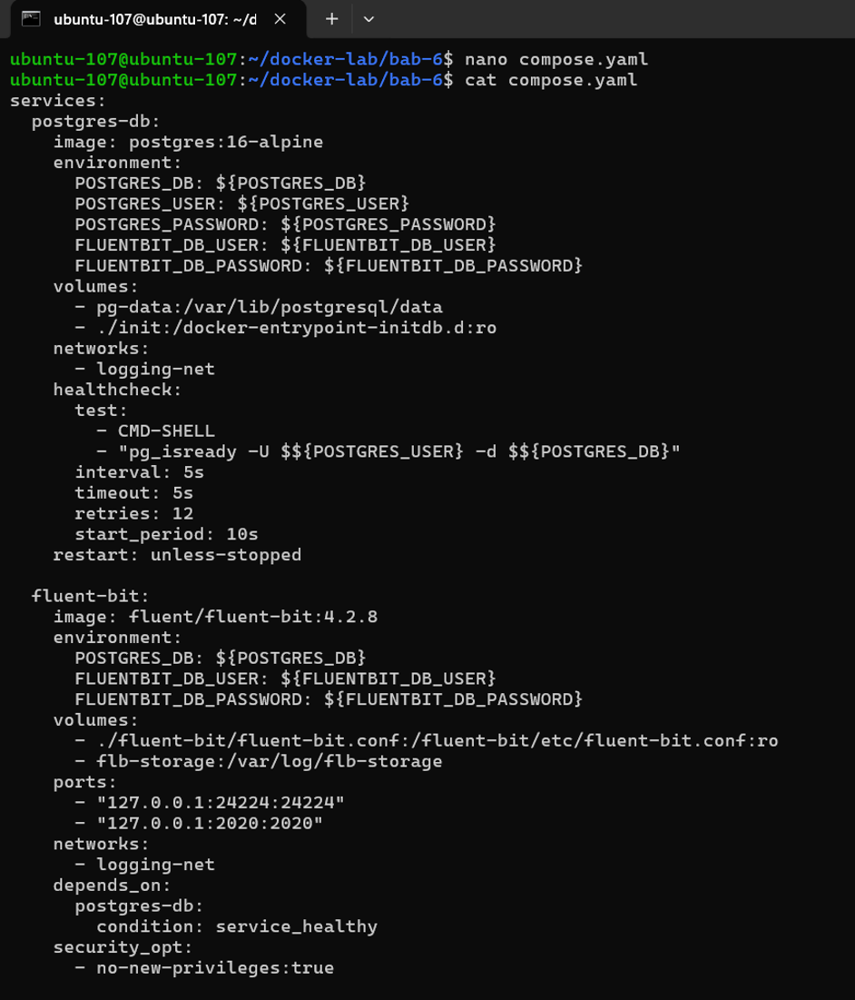

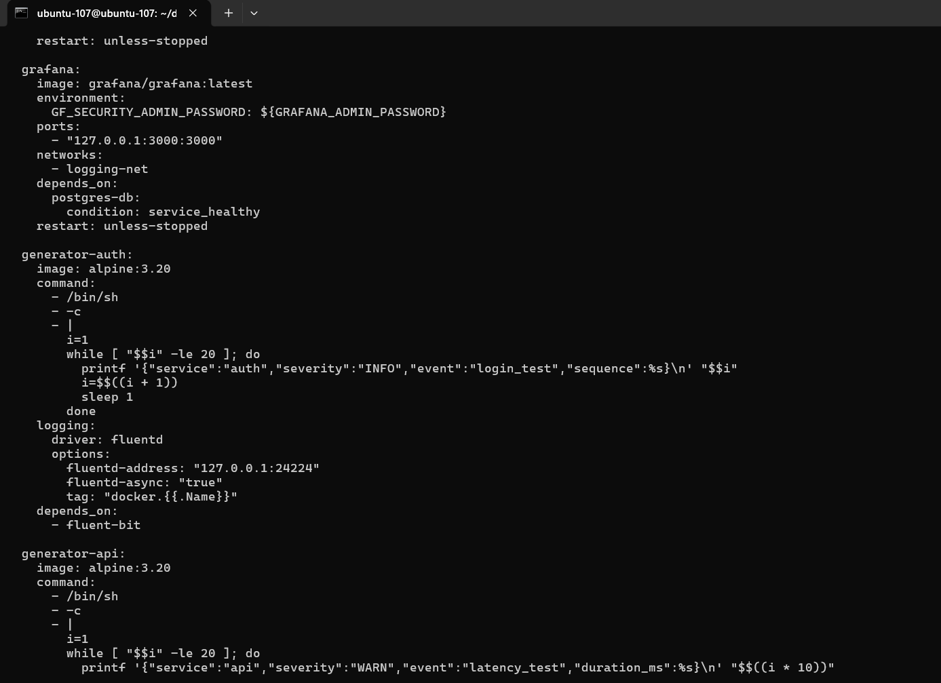

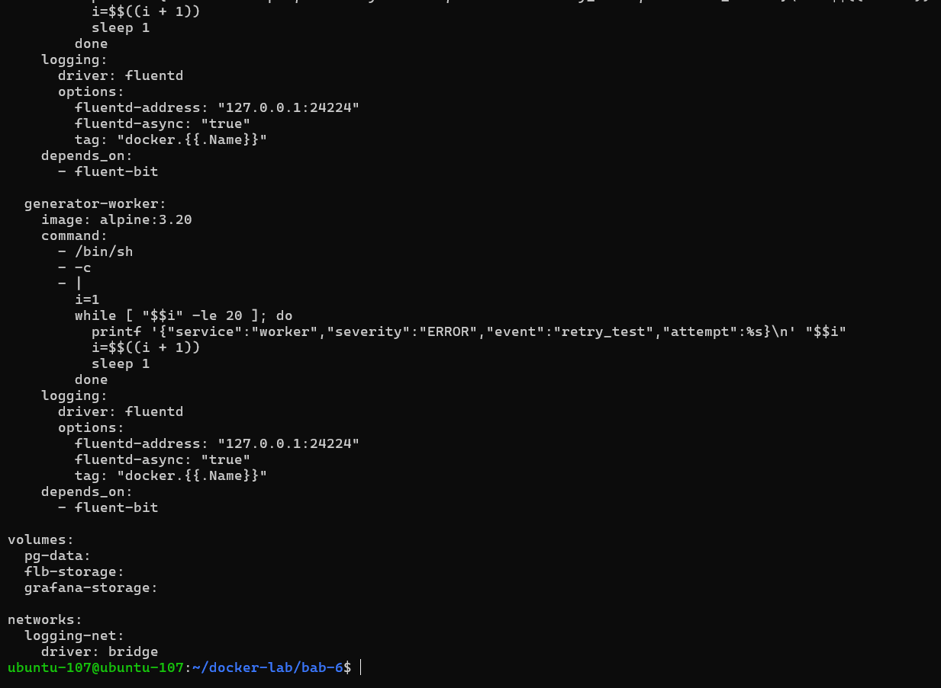

Tambahkan service berikut ke `compose.yaml`, serta volume `grafana-storage` pada bagian `volumes`:

```yaml
  grafana:
    image: grafana/grafana:latest
    environment:
      GF_SECURITY_ADMIN_PASSWORD: ${GRAFANA_ADMIN_PASSWORD}
    ports:
      - "127.0.0.1:3000:3000"
    networks:
      - logging-net
    depends_on:
      postgres-db:
        condition: service_healthy
    restart: unless-stopped
```

Port diikat ke `127.0.0.1`, sehingga Grafana hanya dapat diakses dari loopback VM. Untuk membukanya dari PC, gunakan SSH tunnel, bukan membuka port ke seluruh jaringan.

> **Catatan:** pada screenshot, volume `grafana-storage` sudah dideklarasikan tetapi belum dipasang ke service `grafana`, sehingga data Grafana (data source, dashboard) hilang bila container dibuat ulang. Tambahkan `volumes: - grafana-storage:/var/lib/grafana` pada service. Pertimbangkan juga menyematkan versi image alih-alih `latest`.

### 16.4 Jalankan Grafana

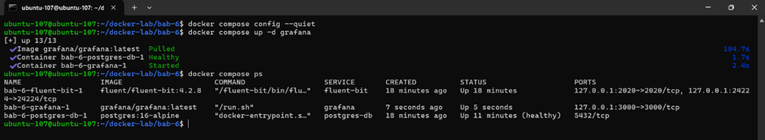

```
docker compose config --quiet
docker compose up -d grafana
docker compose ps
```

Konfigurasi lolos validasi, container Grafana berstatus `Up`, dan PostgreSQL tetap `Healthy`.

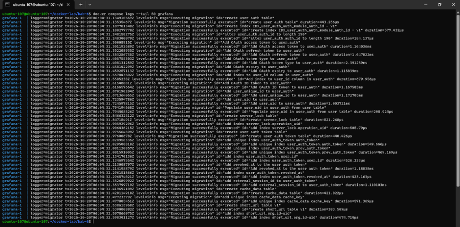

```
docker compose logs --tail 50 grafana
```

Log memperlihatkan migrasi internal, yang normal saat Grafana pertama kali dijalankan.

### 16.5 Login dan tambah data source

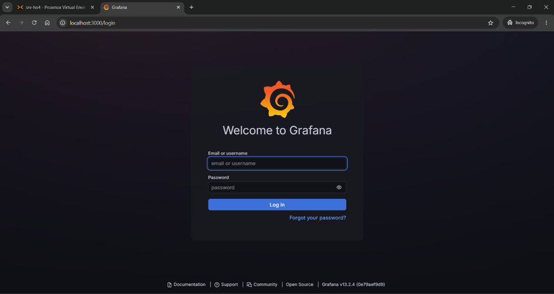

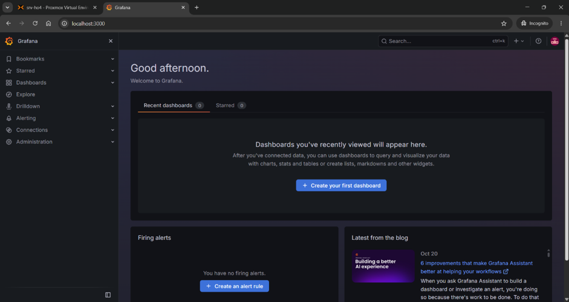

Buka `http://localhost:3000` dan login sebagai `admin` dengan `GRAFANA_ADMIN_PASSWORD`. Halaman login dan beranda tampil, sehingga antarmuka web dapat diakses.

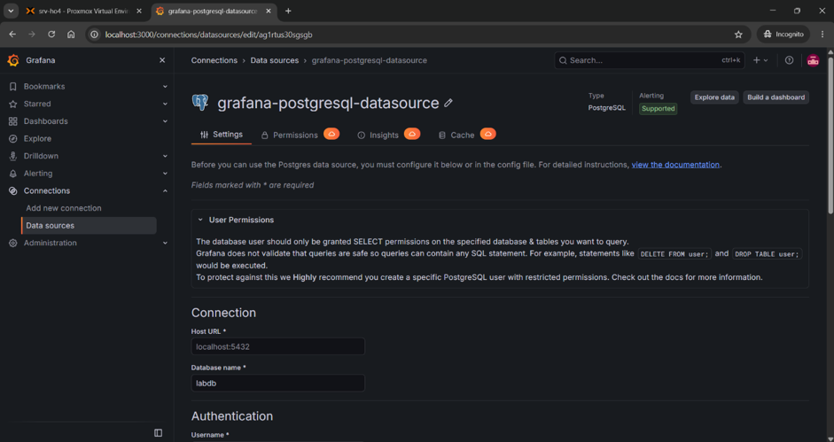

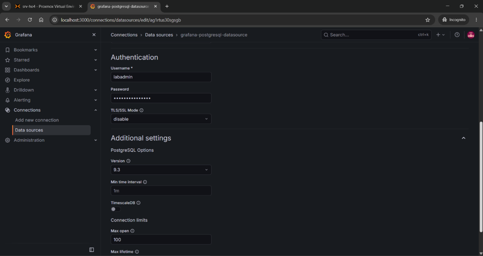

Tambahkan data source PostgreSQL dengan:

| Field | Nilai |
|---|---|
| Host URL | `postgres-db:5432` |
| Database name | `labdb` |
| Username | `grafana_reader` |
| Password | nilai `GRAFANA_DB_PASSWORD` |
| TLS/SSL Mode | `disable` |

Koneksi dibuat dari sisi container Grafana. Karena PostgreSQL tidak memublikasikan port ke host, alamat yang tepat adalah nama service Compose `postgres-db:5432`, bukan `localhost`.

> **Catatan:** screenshot menunjukkan username `labadmin` pada data source. Untuk prinsip hak akses minimum, gunakan `grafana_reader` yang dibuat pada langkah 16.2 agar Grafana tidak memiliki hak administrator database.

### 16.6 Buat panel dashboard

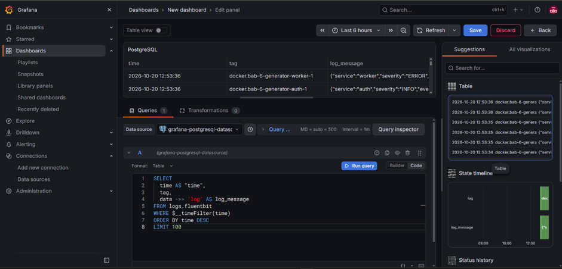

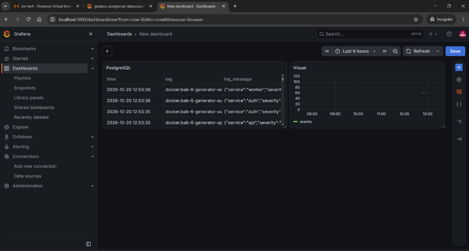

Query panel (format Table):

```sql
SELECT
  time AS "time",
  tag,
  data ->> 'log' AS log_message
FROM logs.fluentbit
WHERE $__timeFilter(time)
ORDER BY time DESC
LIMIT 100
```

`$__timeFilter(time)` adalah macro Grafana yang membatasi data berdasarkan rentang waktu dashboard. Hasilnya tampil sebagai tabel berisi waktu, tag container, dan pesan JSON.

## 17. Lab tambahan: PMB-DEVSECOPS-LAB

Lab ini berada di `~/docker-lab/bab-6/pmb-devsecops-lab` dan menerapkan pola logging yang sama pada aplikasi portal pendaftaran mahasiswa baru (PMB). Portal dapat dibuka melalui `http://localhost:8080`. Demo normal menghasilkan pendaftaran `VERIFIED`; demo insiden menghasilkan `FAILED` setelah tiga percobaan dengan kode `VERIFY-TIMEOUT`.

### 17.1 Setup

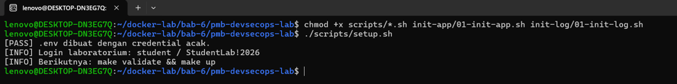

```
chmod +x scripts/*.sh init-app/01-init-app.sh init-log/01-init-log.sh
./scripts/setup.sh
```

| Perintah | Fungsi |
|---|---|
| `chmod +x scripts/*.sh ...` | Skrip Shell dapat dijalankan langsung. `*` adalah wildcard untuk semua file berakhiran `.sh`. |
| `./scripts/setup.sh` | `.env` dibuat dengan credential acak. Terminal menampilkan akun sintetis lab untuk login. |

### 17.2 Struktur Compose

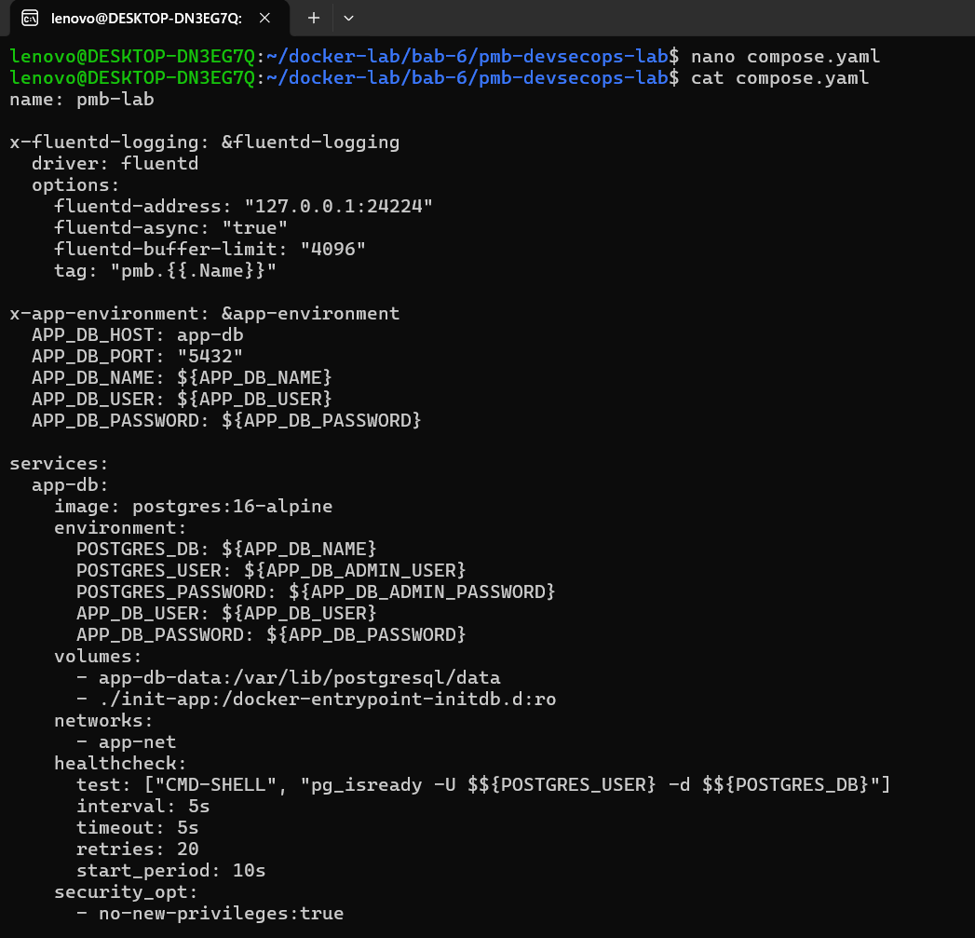

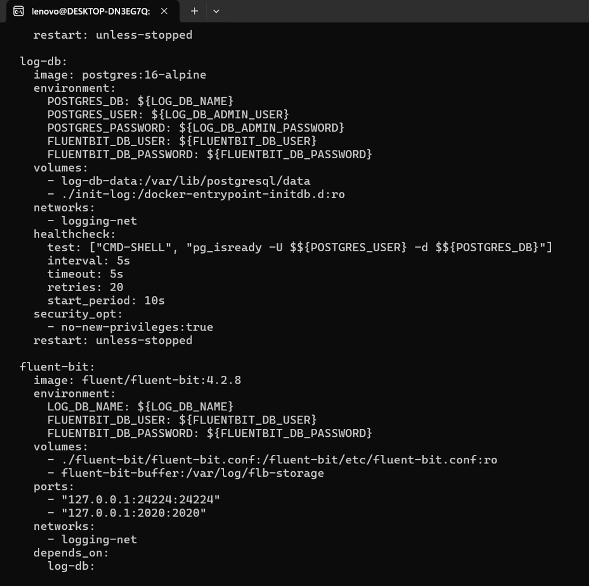

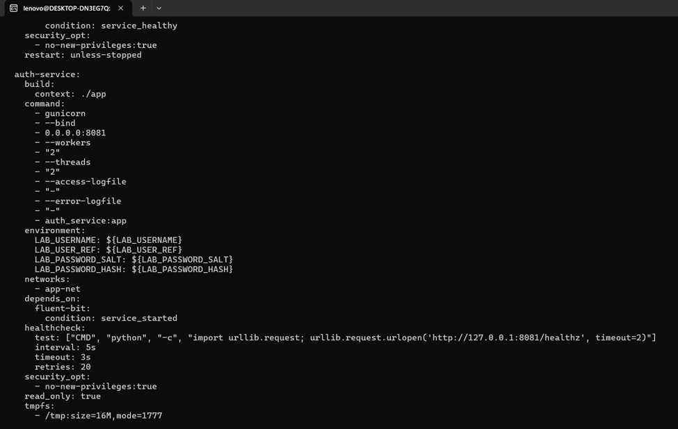

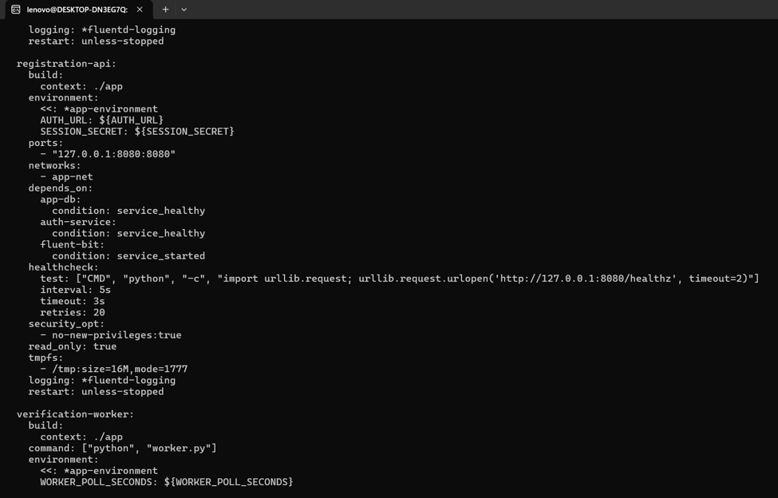

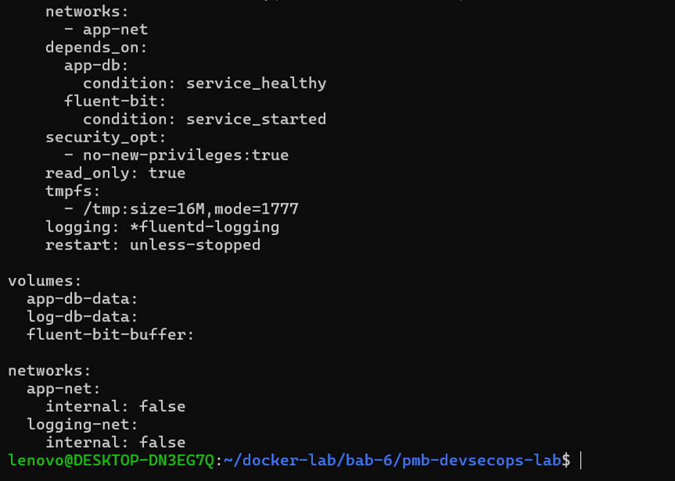

Enam service dibuat: `app-db`, `log-db`, `fluent-bit`, `auth-service`, `registration-api`, dan `verification-worker`.

- Anchor YAML `x-fluentd-logging` dan `x-app-environment` dipakai ulang agar konfigurasi logging (driver `fluentd`, tag `pmb.{{.Name}}`, `fluentd-buffer-limit`) dan variabel database tidak diulang.
- `app-db` (jaringan `app-net`) menyimpan data aplikasi, sedangkan `log-db` (jaringan `logging-net`) menyimpan log. Keduanya dipisah agar data aplikasi dan log tidak bercampur.
- `auth-service`, `registration-api`, dan `verification-worker` dibangun dari `./app`, berjalan dengan `read_only: true`, `tmpfs: /tmp`, dan `no-new-privileges:true`.
- Healthcheck `auth-service` dan `registration-api` memanggil endpoint `/healthz`.
- Definisi akhir network diubah menjadi `internal: false` pada `app-net` dan `logging-net`. Ini menonaktifkan isolasi eksternal; kedua network tetap terpisah, tidak digabung. Pada konfigurasi lab, setelah network dibuat ulang, port lokal dapat diakses.

### 17.3 Validasi statis


```
./scripts/validate.sh
```

Parser YAML menemukan enam service, tiga unit test lulus, dan `docker compose config` lulus.

### 17.4 Build dan jalankan


```
docker compose up -d --build
```

Image yang dibutuhkan diunduh atau dibangun, lalu network, volume, dan enam container dibuat.


```
docker compose ps
```

Semua service berjalan. Database dan API sehat; portal dan Fluent Bit memiliki port host yang dipublikasikan.


```
curl -fsS http://127.0.0.1:8080/healthz
curl -fsS http://127.0.0.1:2020/api/v1/health
```

Portal menjawab `status: ok` dan endpoint Fluent Bit merespons. `curl -fsS`: `-f` menandai HTTP error sebagai gagal, `-s` menyembunyikan progress, dan `-S` tetap menampilkan pesan error.

### 17.5 Demo normal dan verifikasi log


```
./scripts/demo-normal.sh
./scripts/verify.sh
```

Database menunjukkan satu pendaftaran `VERIFIED` pada percobaan 1. `verify.sh` melaporkan satu transaksi, 88 record log, service sehat, dan pemeriksaan indikasi secret lulus.

### 17.6 Demo insiden


```
./scripts/demo-incident.sh
./scripts/set-incident.sh none
```

Pendaftaran menjadi `FAILED` setelah tiga percobaan dengan kode `VERIFY-TIMEOUT`. Request ID yang ditampilkan dipakai pada `queries/incident-analysis.sql`. Setelah demo, mode insiden dikembalikan ke `none`.

### 17.7 Pengujian dari browser


Halaman login, formulir pendaftaran, dan status dapat dibuka. Halaman status menampilkan satu transaksi `VERIFIED` dan satu `FAILED`, sesuai dua demo. Formulir menjelaskan kontrak log: `request_id` untuk korelasi, `user_ref` yang tidak langsung mengungkap identitas, status, program, event, waktu, retry, dan kode kegagalan worker. Nama, email, password, cookie, dan token tidak ditulis ke log aplikasi.

### 17.8 Kumpulkan evidence


```
./scripts/collect-evidence.sh
```

Evidence dibuat di direktori `reports/`, dan file `.env` tidak disertakan.

## Hasil

- Fluent Bit menerima log dari tiga generator melalui Docker logging driver `fluentd`, dengan tag per container.
- Log tersimpan di PostgreSQL pada `logs.fluentbit` dengan kolom `tag`, `time`, dan `data` (JSONB); total 60 event dari 3 sumber.
- Query analisis menghitung total event, distribusi per tag, severity `ERROR`, dan laju ingest per menit.
- Buffer filesystem, checksum, dan `fluentd-async` disiapkan untuk ketahanan saat database tidak tersedia; uji buffering menaikkan jumlah record dari 60 menjadi 120.
- Grafana terhubung ke PostgreSQL dan menampilkan log dalam panel tabel.
- Lab PMB berjalan dengan enam service; demo normal menghasilkan `VERIFIED`, demo insiden menghasilkan `FAILED` dengan kode `VERIFY-TIMEOUT`, dan evidence terkumpul di `reports/`.

## Catatan keamanan

- Jangan unggah `.env`, password, atau token ke repository. Samarkan password pada screenshot sebelum dipublikasikan.
- Port Fluent Bit, Grafana, dan portal hanya diikat ke `127.0.0.1`.
- Gunakan akun database dengan hak minimum (`fluentbit_user` untuk ingest, `grafana_reader` untuk baca).
